# 备考有方产品需求文档 · 白板修订版

| 项目 | 内容 |
| --- | --- |
| 文档修订 | 2.31 · 2026-11-25 |
| 学习体验基准 | 同事体验版 HTML 的页面、23 个主题及原有教学内容 |
| 运行基准 | v0.4.0-alpha.1 试用版包含个人学习、知识卡、学员模拟及 A4 打印。可打开的独立原型为 2.25 |
| 改动依据 | 白板 PDF 批注、11 月 21 日产品走查及黑白漫画角色审阅。分步改动见[修改记录](../CHANGELOG.md) |
| 验收载体 | 独立本地原型，角色、内容发布和个人数据使用浏览器演示 |

本文记录白板原型和正式工程的对应关系。独立原型的用户记录、图片、维护草稿及发布操作保存在原浏览器。正式工程按账号保存个人学习和模拟答卷数据。学员页可在服务器完成随机组卷、交卷、评分、纸笔自核及模拟复盘排期。首页显示服务器安排的复练任务。旧演示卷可从试卷库在原设备回看。

首轮接入服务器的页面、题库补充方式及待定事项见[服务器试用版范围](PRD.md#服务器试用版范围)。页面的数据来源和接入顺序见[页面接入设计](ARCHITECTURE.md#服务器试用版页面接入)。本页保留独立原型 2.25 的交互标注，并在各页的「正式工程」中记录本机试用构建的对应实现。

截图均使用演示数据。带「正式工程」标注的图片来自 `v0.3.0-alpha.1`，其余来自独立原型。蓝色编号对应下方交互表。

学习端和维护端使用暖白纸色、墨线描边和柔和色块。各页面共用绿色主操作、带边缘厚度的圆角按钮和轻量按压反馈。答题选项用蓝色表示当前选择，答题卡用蓝色边框表示当前题、绿色背景表示已作答。进度条旁保留数量说明。复盘使用短过渡，启用减少动态效果时关闭过渡和按压位移。

## 页面目录

| 编号 | 页面或区域 | 入口 |
| --- | --- | --- |
| P01 | 登录、会话和账号 | 打开站点、个人菜单 |
| P02 | 首页与目标设置 | 学习空间首页 |
| P03 | 陌生案例入门 | 首页新手入口、题目页答题帮助 |
| P04 | 知识地图 | 知识学习 |
| P05 | 优先级、主题组和知识卡 | 知识地图的 S / A / B 卡片 |
| P06 | 题目列表 | 题目练习、知识卡的主题自测 |
| P07 | 单题提取与变式 | 题目列表或主题自测 |
| P08 | 错题集 | 题目练习子入口、复盘 |
| P09 | 模拟试卷库 | 模拟考试 |
| P10 | 模拟作答 | 新卷、继续草稿或纸笔录入 |
| P11 | 交卷确认 | 作答页查看交卷清单 |
| P12 | 答题记录 | 模拟考试子入口 |
| P13 | 本次答卷评阅与复盘 | 交卷成功、答题记录 |
| P14 | 打印与下载 | 知识地图、试卷和答卷复盘 |
| M01 | 题库管理、编辑和历史 | 维护工作台 |
| M02 | 政策与时事材料、融合审核 | 维护工作台 |
| M03 | 账号管理 | 管理员工作台 |

## P01 登录、会话和账号

### 正式工程

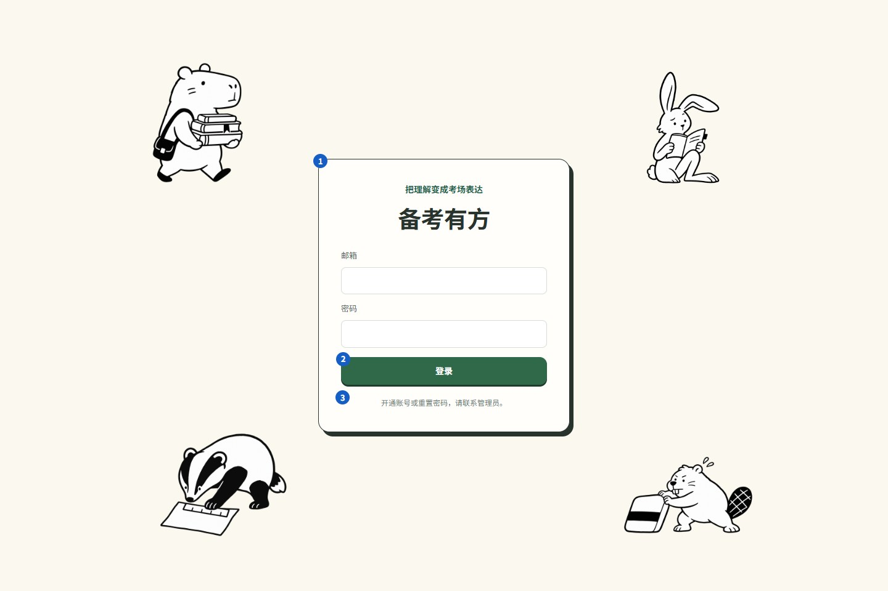

| 图中编号 | 页面元素 | 操作、状态和联动 |
| --- | --- | --- |
| 1 | 登录卡片 | 沿用原型中央卡片和四角黑白插图。邮箱和密码由服务器验证。 |
| 2 | 登录 | 验证成功进入原访问页面或 P02。维护权限由账号决定。 |
| 3 | 账号说明 | 无账号或需要重置密码时联系管理员，通过 M03 管理。 |

### 交互说明

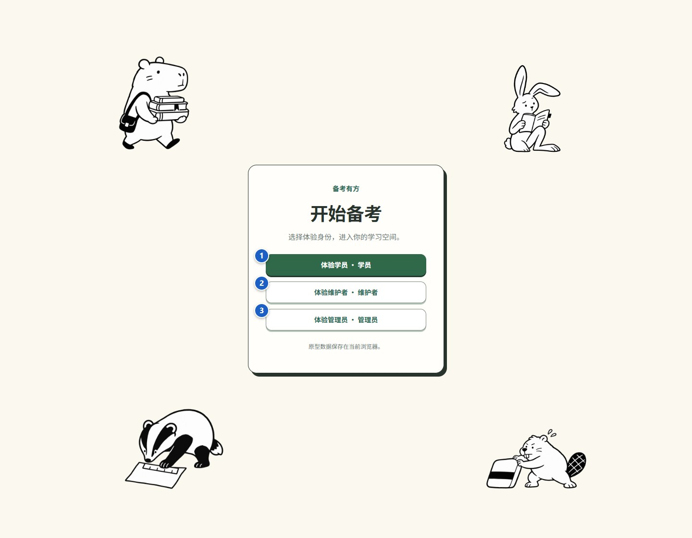

| 图中编号 | 页面元素 | 操作、状态和联动 |
| --- | --- | --- |
| 1 | 学员入口 | 选择启用的体验学员身份，进入 P02。该用户只能看到自己的学习记录。 |
| 2 | 维护者入口 | 进入学习空间后，可从侧栏打开 M01 和 M02。 |
| 3 | 管理员入口 | 具备维护权限，并可打开 M03。停用的账号不出现在选择列表中。 |

### 功能规则

- 登录选项放在中央卡片。水豚抱书、野兔翻笔记、獾用尺对边和河狸推橡皮分布在卡片外围，保留空白和清晰的登录焦点。窄屏保留水豚和河狸两处装饰。
- 学员登录后进入首页。学员可学习、练题、模拟、评阅自己的答卷。维护者可另外维护题库、登记和复核时政。管理员可额外开通、停用账号。
- 正式站点使用 alpha.3 的邮箱密码、服务器会话和来源校验。失败展示凭据、会话过期、权限或连接状态，提供对应重试入口。改密和停用撤销旧会话。
- 原型通过选择演示身份进入，便于切换角色验收。账户记录按账号分别保存。切换站点或清除浏览器数据会影响可见本机记录。
- **联动** → P02 首页、M03 账号管理。无账号或权限不足时阻止进入维护页面。

## P02 首页与目标设置

### 正式工程

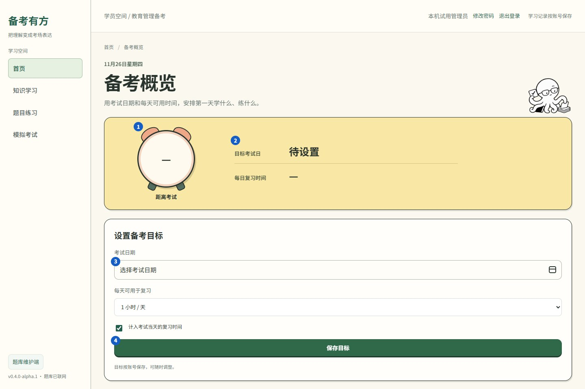

| 图中编号 | 页面元素 | 操作、状态和联动 |
| --- | --- | --- |
| 1 | 考试闹钟 | 展示距离考试的天数。当天显示「考试今天」，过期提示调整目标。 |
| 2 | 考试设定 | 同一卡片显示考试日和每日复习时间。保存后在卡片内提供「调整目标」。 |
| 3 | 考试日期 | 点击整个日期框打开月历。 |
| 4 | 保存目标 | 保存到当前账号，日历、三档备考节奏、今日任务和 P09 推荐读取同一目标。 |

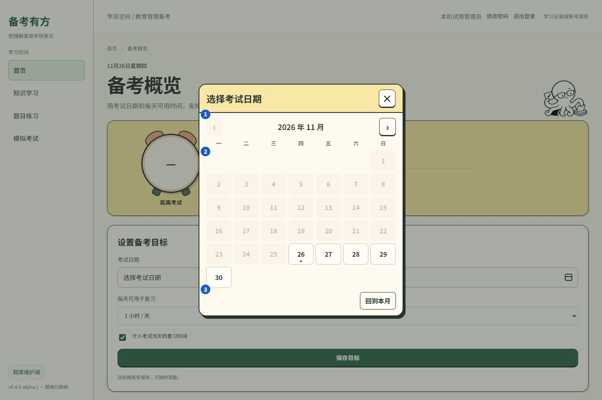

| 图中编号 | 页面元素 | 操作、状态和联动 |
| --- | --- | --- |
| 1 | 月份导航 | 更换月份，可以用 Escape 关闭。 |
| 2 | 日期格 | 可选今天或未来日期；选择后回填日期框并关闭月历。 |
| 3 | 回到本月 | 将月历定位到当前月份。 |

今日任务直接展示题目入口与完成进度，完成项降低亮度。到期复练优先排入任务；未到期的复练显示下次日期。右侧同时列出三档节奏，突出当前推荐。每个任务可从 P07 返回首页。

### 交互说明

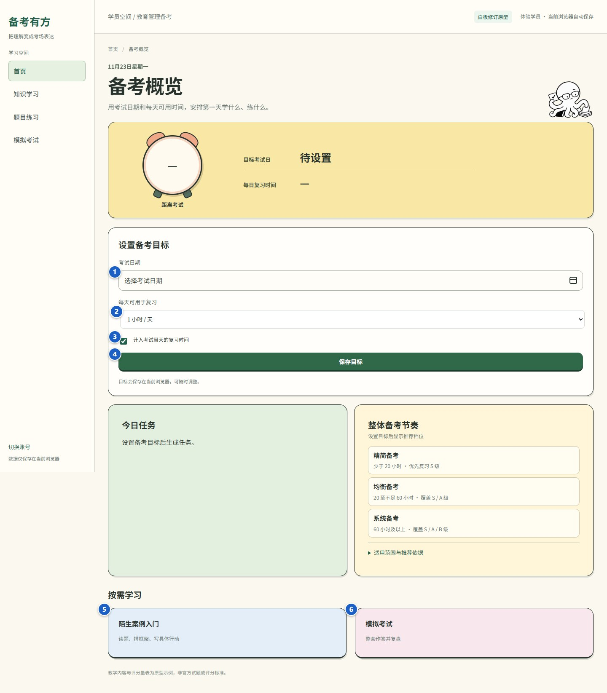

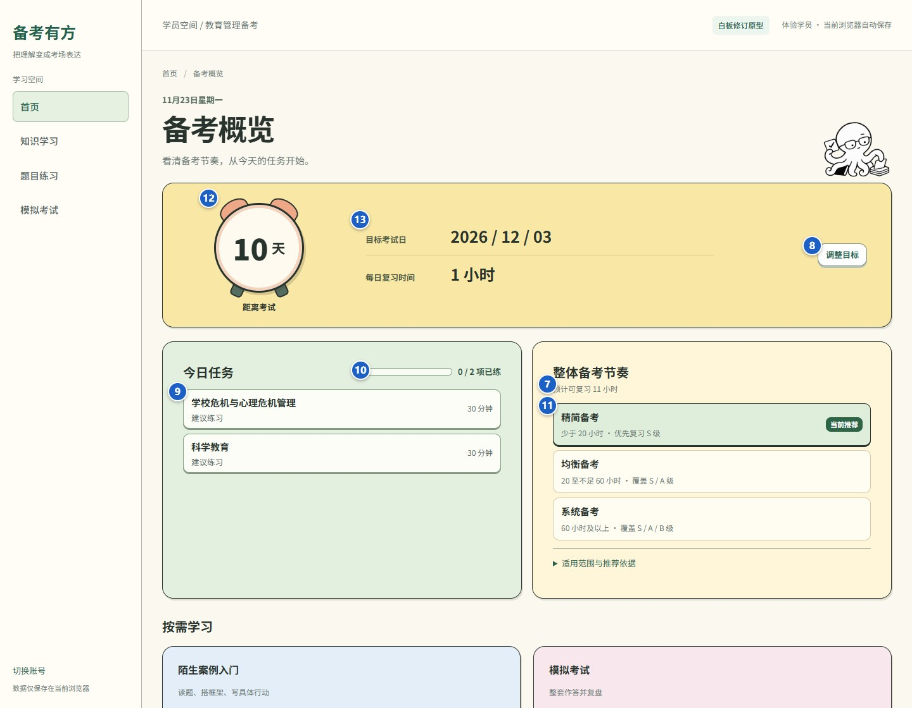

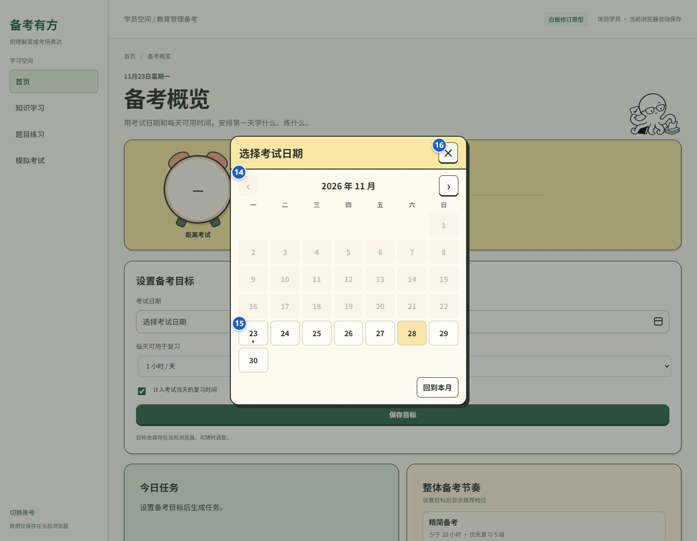

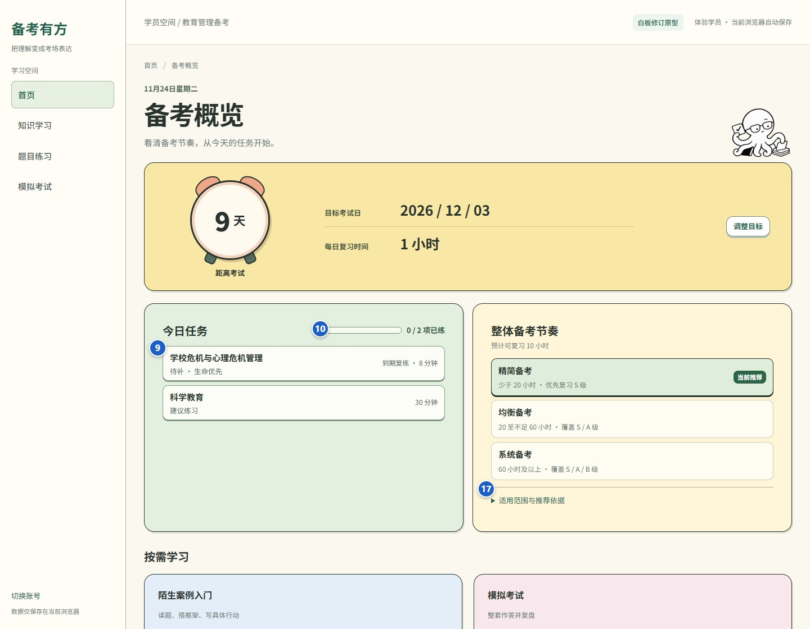

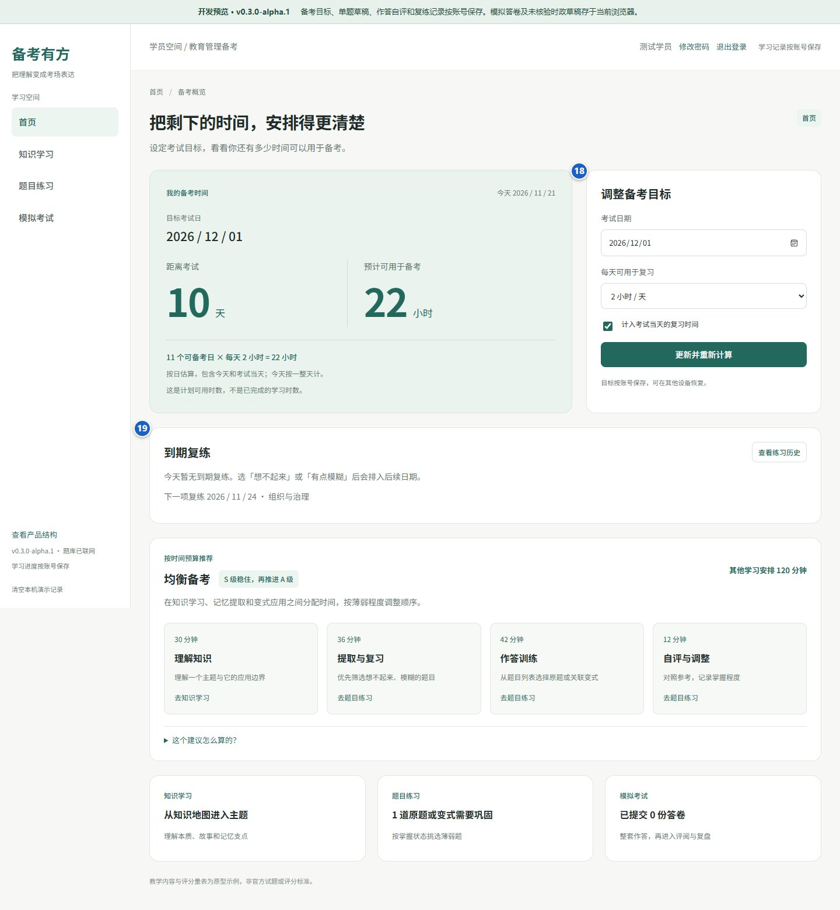

| 图中编号 | 页面元素 | 操作、状态和联动 |
| --- | --- | --- |
| 1 | 考试日期 | 点击日期栏任意位置，或按 Enter，打开漫画风月历。过期目标可回到本表单更新。 |
| 2 | 每日复习时长 | 选择 30 分钟至 4 小时的档位，保存后影响今日任务和 P09 推荐。 |
| 3 | 计入考试当天 | 默认勾选。取消时少算考试日当天，最少为 0 天。 |
| 4 | 保存目标 | 校验后保存，并切换到备考概览。调整模式下取消会保留已保存目标。 |
| 5 | 陌生案例入门 | 打开 P03。返回时仍显示当前目标和任务。 |
| 6 | 模拟考试 | 进入 P09，试卷时长档位读取已保存的每日复习时长。 |
| 7 | 预计可复习时数 | 在备考节奏标题下显示用于推荐档位的总时数。没有目标时提示先设置。 |
| 8 | 调整目标 | 回填现有设置，调整保存后重新计算。 |
| 9 | 今日任务列表 | 先显示到期复练、安排原因和建议用时，再列日常练习。整条进入 P07 指定题。今天已自评或已复练的任务降低视觉强调。未到期时显示最近一次安排。 |
| 10 | 今日任务进度 | 绿色进度条和「已练数 / 任务总数」记录今天做过多少项。选择「想不起来」也算完成一次回忆自评，掌握状态仍为「想不起来」。 |
| 11 | 整体备考节奏 | 自上而下列出精简、均衡、系统，标明时数范围与复习优先级。有可用时间时高亮并标注「当前推荐」。 |
| 12 | 考试闹钟 | 表盘显示距考试的日历天数。当天显示「考试今天」，日期已过显示「已过期」。 |
| 13 | 目标考试日与每日复习时间 | 与闹钟同卡显示。闹钟居左，右侧两行依次展示已保存的日期和每日投入。 |
| 14 | 月份切换 | 左右箭头切换前后月份。「回到本月」返回当前月份。当前月之前的月份不可向前切换。 |
| 15 | 日期格 | 大尺寸日期按钮。今天有圆点，已选日期有浅绿色底，过去的日期不可选。点选后关闭月历并回填日期栏。 |
| 16 | 关闭日历 | 点击关闭按钮或按 Esc，保留之前填写的日期。 |
| 17 | 适用范围与推荐依据 | 展开说明当前适用于教育管理案例教学练习，显示分档依据。目标招考范围及核验日期待确认。 |
| 18 | 账号备考目标（正式工程） | 保存到当前账号，换设备自动回填。并行修改时提供采用服务器目标或保留当前填写两个选项。 |
| 19 | 账号复练安排（正式工程） | 展示到期项、已练项及最近一次未来安排。从这里进入独立复练，或回看练习历史。 |

### 功能规则

- 首页标题右侧在桌面和窄屏上均只显示章鱼整理卡片的黑白漫画插图。实际考试日期和剩余天数读下方考试闹钟卡片。
- 首页顶部同一卡片展示考试闹钟、目标考试日和每日复习时间，下方展示今日任务和整体备考节奏。每日投入支持 0.5、1、1.5、2、3、4 小时，默认计入考试当天，保存才更新，取消保留旧设置。
- 闹钟的天数等于考试日期与本地当前日期之差，每天跨日更新。距考试 7 天内，闹钟卡片使用暖橙色。
- 预计可复习时数 = 可备考日数 × 每日时长。可备考日数 = 日历天数差 + 是否计入考试日，最低为 0。计入考试日影响预计时数及任务可用日，模拟卷时长按每日复习时长推荐。日期过期提醒更新。未设置目标或预算为 0 时展示对应状态。
- 总时数少于 20 小时为精简，20 至不足 60 为均衡，60 起为系统。优先级范围分别为 S、S/A、S/A/B。距考试不超过 7 天时建议优先复练。
- 今日任务优先安排到期或逾期的复练，每项暂按 8 分钟估算，同主题有复练时只展示一个入口。剩余时间分给建议练习，每项 10 至 30 分钟。同一天调低预算时保留已练记录；未排入的待复练继续保留。设置有效目标后才分配当天时间。减少动态效果时进度直接显示目标值。
- 首页保留备考节奏文字说明、案例入门和进入模拟的快捷入口。每个目标页面在首页只出现一个同用途入口。
- **联动** → P03 案例、P07 自评与到期复练、P09 限时练习、P13 安排补练。任务时间使用建议预算，完成状态来自对应练习的当日自评。

**正式工程。** 首页保存账号目标和时区，恢复已保存的下一次复练。目标在另一设备修改时，提示采用服务器目标或保留当前填写再提交。今日已复练的项目占用建议预算。

| 图中编号 | 页面元素 | 操作、状态和联动 |
| --- | --- | --- |
| 1 | 来自模拟复盘 | 服务器按账号安排次日复练。首页显示日期和来源，任务到期后可进入 P07。一个主题有待办时沿用已有安排。 |

## P03 陌生案例入门

### 交互说明

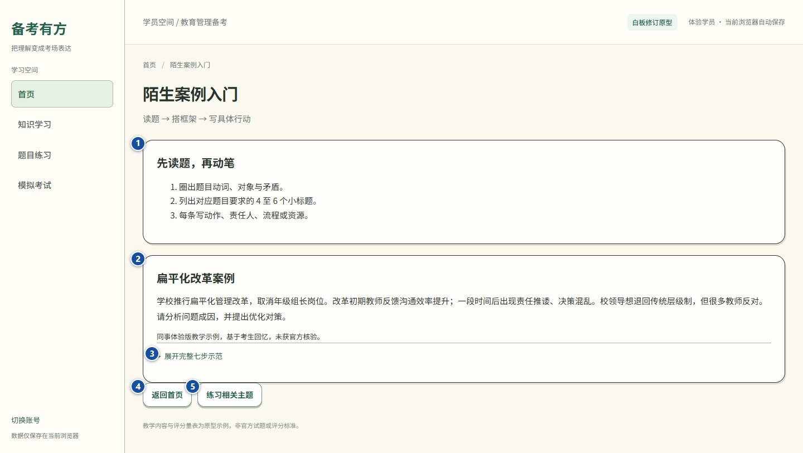

| 图中编号 | 页面元素 | 操作、状态和联动 |
| --- | --- | --- |
| 1 | 三步入门 | 按读题、搭框架、写具体行动说明方法。 |
| 2 | 案例题干 | 展示示范题与资料性质，供用户先读题。 |
| 3 | 完整七步示范 | 默认收起，展开看每一步的说明与示例。 |
| 4 | 返回入口 | 从首页进入时返回 P02，从题目帮助进入时返回 P07 并恢复草稿。 |
| 5 | 练习相关主题 | 打开 P06，并带入案例对应的主题筛选。 |

### 功能规则

- 放在首页的入门卡片下，从简明的「读题、搭框架、写具体行动」三步开始。案例使用同事体验版的扁平化改革示范，注明教学资料及未获官方核验的来源性质。
- 首屏展示题干与三步方法。点击展开后按「定方向、分析原因、明确目标、提出措施、落实保障、评价改进、收束」展示说明与示例。支持收起及进入相应主题练习。
- **联动** → P02 返回首页，或返回进入帮助前的 P07 题目。往返保留作答草稿。

## P04 知识地图

### 正式工程

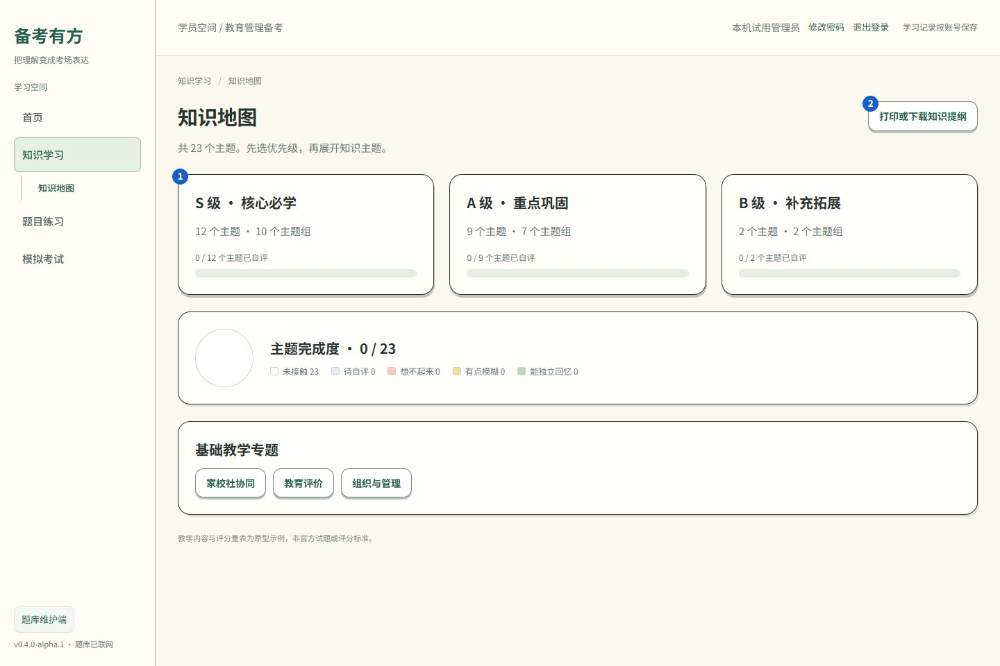

| 图中编号 | 页面元素 | 操作、状态和联动 |
| --- | --- | --- |
| 1 | 优先级整卡 | 整个区块可点击，跳转到对应等级的 P05 列表。 |
| 2 | 打印知识提纲 | 进入 P14，按知识库中的主题、优先级或掌握度筛选。 |

### 交互说明

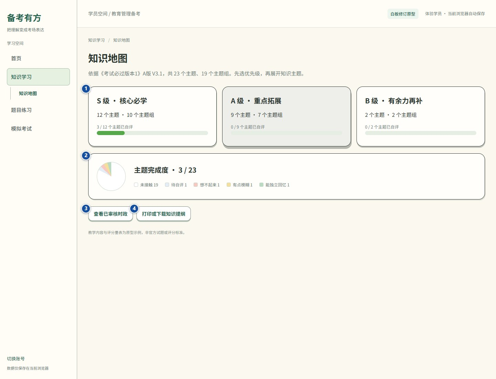

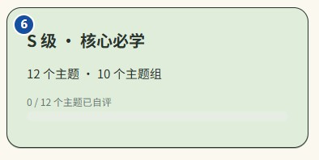

| 图中编号 | 页面元素 | 操作、状态和联动 |
| --- | --- | --- |
| 1 | S / A / B 卡片 | 整卡为链接，点击标题、进度条或卡内空白处均进入 P05 对应级别。键盘 Tab 定位后按 Enter 进入。 |
| 2 | 主题完成度 | 按当前版本的自评汇总分类和数量，完成 P07 自评后刷新。 |
| 3 | 已审核时政 | 查看 M02 核验并发布、仍适用的材料。无可见材料时显示空状态。 |
| 4 | 打印或下载知识提纲 | 进入 P14 知识模板，包含已审核的适用材料。 |
| 5 | 卡片悬停 | 细指针悬停时背景转浅灰（#EEEEEB）、上浮 3 px，底部阴影加深，160 ms 过渡。 |
| 6 | 卡片按下 | 按下时背景转浅绿、下压 2 px、阴影缩短，70 ms 反馈。松开完成跳转。 |

### 功能规则

- 保留 S 核心必学、A 重点拓展、B 有余力再补。沿用体验版 19 组、23 主题，S 级 10 组 12 主题、A 级 7 组 9 主题、B 级 2 组 2 主题。
- 默认卡片为暖白纸色、墨线描边和底部阴影。使用原生链接覆盖整卡，当前预设应用于 S、A、B 三张入口卡。动效以 `card-motion` 类按需复用，后续卡片由用户确认采用范围。
- 键盘焦点显示绿色外框。触屏支持直接整卡点击。系统开启减少动态效果时，保留颜色反馈，省去位移与过渡。
- 每档展示已完成自评的主题数及总数。总览饼图和文字图例按未接触、待自评、想不起来、有点模糊、能独立回忆统计，展示每类计数。完成度 = 已完成至少一次当前版本自评的主题数 ÷ 当前主题数。
- 主题状态以该主题当前版本且已发布练习的自评聚合。任何一题薄弱先显示薄弱，其次模糊，再显示已掌握。无已评分题而有接触时显示待自评。单题颜色由用户选择，分数独立。
- 提供已审核时政列表入口、知识提纲打印/下载入口。无已审核材料时给出空状态。
- **联动** → P05 分级主题，P07 自评同步进度，M02 发布内容，P14 知识提纲。

## P05 优先级、主题组和知识卡

### 正式工程

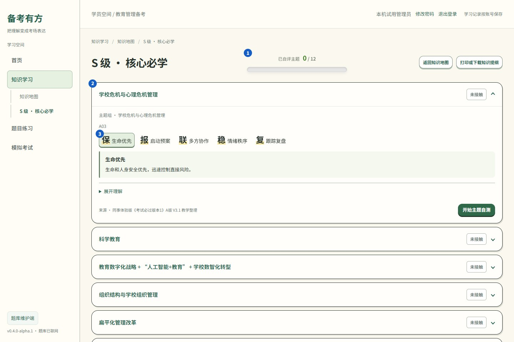

| 图中编号 | 页面元素 | 操作、状态和联动 |
| --- | --- | --- |
| 1 | 知识主题掌握进度 | 显示当前等级中完成过至少一次当前版本自评的主题数。 |
| 2 | 主题条 | 整条可展开，收起时同一行显示掌握度。 |
| 3 | 知识卡速记 | 点按高亮速记字，可展开该要点的完整解释。从已发布主题可继续进入自测。 |

### 交互说明

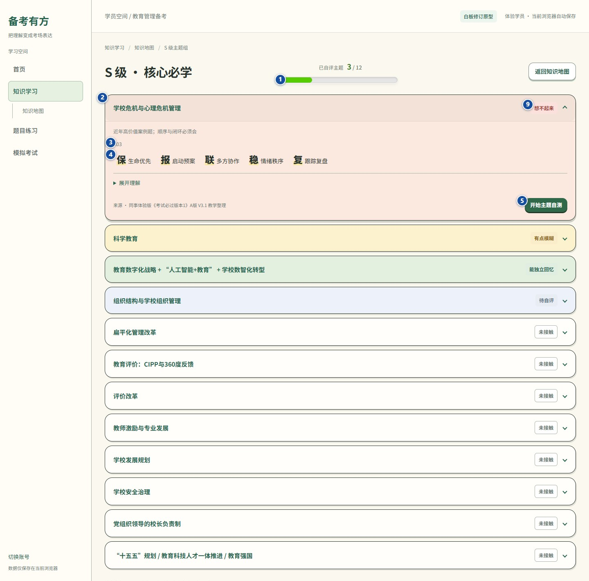

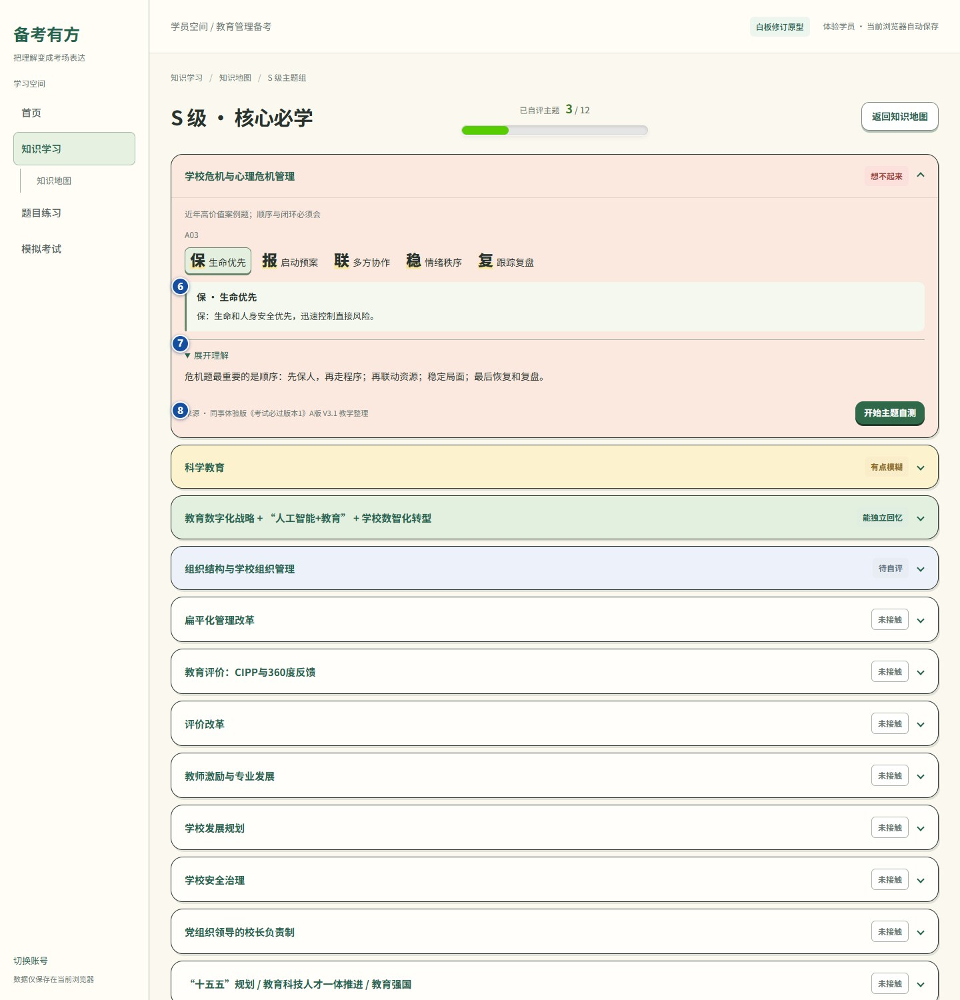

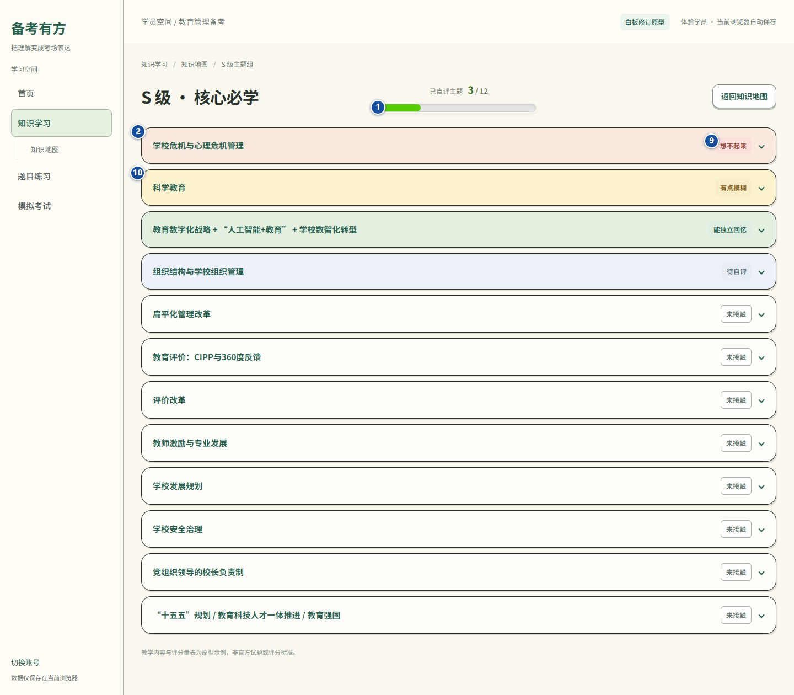

| 图中编号 | 页面元素 | 操作、状态和联动 |
| --- | --- | --- |
| 1 | 标题旁进度条 | 去掉外部整行卡片，宽屏在级别标题同行居中放置最多 280px 的短进度条，上方显示已自评数/主题总数。使用多邻国风格纯亮绿填充、浅灰轨道和轨道轻阴影，填充不做渐变或内部高光，与下方掌握度色卡区分。窄屏在标题下一行居中。 |
| 2 | 知识主题栏 | 点击整条标题行展开或收起，右侧箭头同步旋转。往返练习保留展开项。 |
| 3 | 主题卡正文 | 展示主题号、速记提纲与解释，不重复显示标题或掌握标签。 |
| 4 | 速记提纲 | 每段由强调的速记字或词与简短表达组成。宽屏尽量排成一行，窄屏自然换行。点击一段，在本卡展开对应解释。 |
| 5 | 开始主题自测 | 打开 P06，带入该主题作为筛选条件。 |
| 6 | 记忆点解释 | 展示当前选中记忆点的完整解释。点其他速记段切换解释，再点选中段收起。键盘 Enter、空格可操作。 |
| 7 | 展开理解 | 展开整个主题的核心一句话，再点收起。 |
| 8 | 教学来源 | 在卡片底部展示来源，有已发布且适用的时政材料时在卡内补充。 |
| 9 | 常驻掌握标签 | 与主题名同一行右对齐，收起时仍可见，沿用未接触、待自评、想不起来、有点模糊、能独立回忆五种状态。 |
| 10 | 整条状态色 | 未接触暖白、待自评浅蓝、想不起来浅红、有点模糊暖黄、能独立回忆浅绿；悬停只叠加轻灰反馈，移出恢复状态底色。 |

### 功能规则

- 进入某级后显示主题进度条，每个知识主题对应一个独立下拉条。原有双主题组分别展示各主题标题与状态，组合关系在展开后的说明保留，不能用一个汇总状态代替两个主题的状态。
- 本级进度是非交互统计，取消与主题栏相似的整行外框，置于页标题与返回按钮之间。短条使用纯亮绿色填充与浅灰轨道，仅保留轨道轻阴影，与暖白页面和浅红/黄/绿/蓝的掌握度栏区分；0、部分和全部完成均使用真实计数。手机上为标题下方居中的短条，不横向挤压标题或按钮。进度口径保持已自评主题数/本级主题总数。
- 掌握标签放在下拉标题行右侧，标题、标签、箭头均可点击展开；整条容器沿用该主题掌握度底色。展开正文不重复放置掌握标签。状态仍由 P07 既有自评聚合，底色不改变自评或客观评分规则。
- 悬停叠加浅灰、轻微加强阴影，按下有轻量下压；标题行的键盘焦点有绿色描边。展开/收起以约 240ms 的高度动画配合正文淡入淡出和箭头转动，结束后解除高度限制，长解释可自然撑开。快速反复点击按最后一次意图完成，不锁死高度或丢失展开状态。
- Enter、空格保留原生下拉操作；触屏点击整条标题行。系统设置减少动态效果时立即展开/收起，保留颜色和焦点反馈，取消位移、旋转过渡和淡入淡出。窄屏标题可换行，掌握标签仍留在同一标题栏右侧，不溢出页面。
- 速记提纲显示在展开正文中，完整解释点击速记段展开。同卡每次展开一个记忆点，跨卡互不影响。
- 速记提示可为一个字、多个字或留空。速记提示和简短表达分别维护，允许速记字未出现在解释正文中。现有内容覆盖 3 至 7 个记忆点。
- 标题栏使用知识卡主题名，卡片内省去重复标题。完整核心句在「展开理解」中查看。返回本级保留各主题展开项和选中记忆点，切换账号清除展开状态。
- 已发布时政关联按主题展示引用、日期、适用范围。速记提纲、主题理解和时政增补使用各自内容字段。
- **联动** → P06 主题练习或 P07 对应题；返回时保留级别和展开位置。P07 自评刷新本页和 P04 的进度。

### 知识库数据约定

原型的 23 个知识主题通过 `knowledgeId` 引用知识卡，109 个记忆点显式记录速记提示、简短表达与原始解释。简短表达为本次展示整理，原始解释和核心句完整保留。P05、P07 提示和打印提纲从同一份知识卡读取。

| 字段 | 约定 |
| --- | --- |
| `id`、`topicId` | 知识卡稳定编号与归属主题。主题通过 `knowledgeId` 引用卡片。 |
| `version` | 内容版本号，修改已发布知识时创建下一版。 |
| `title`、`overview` | 主题标题及整体理解。 |
| `points` | 有序记忆点数组，支持不同数量。 |
| `points[].id` | 点的稳定编号，后续编辑保持编号。 |
| `points[].cue` | 独立的速记字或词，可为空。 |
| `points[].summary` | 列表展示的简短表达。 |
| `points[].detail` | 完整解释。现有数据沿用原文。 |
| `source` | 教学内容来源。 |

后续导入沿用此结构。人工录入可使用「知识卡」和「记忆点」两张表，通过卡片编号关联。外部知识库在导入时映射字段，缺少速记提示时先保留正文供维护者补齐。导入检查编号唯一性、必填字段、主题归属和记忆点关联，经过预览确认后发布。正式知识库的上传、接口和数据库版本管理仍属于后续实现。

### 知识点客观题扩充

- 基于现有 23 张知识卡保留 46 道单选、23 道填空，判断扩充为 46 道，共 115 道知识卡教学编题；含原有题目的题库总数为 181 道。单选中保留 12 道基础题，34 道升级为辨析题；判断包含 23 道基础题和 23 道新增辨析题。属于独立原题，不把知识正文或依据当成变式。
- 拓展限于原要点的提问改写、应用情境和反向干扰项；不引入知识库之外的定义、政策条文、年份、统计数字或事实结论。填空从原文解释中挖去完整词语，不把速记字当成唯一答案。
- 每题包含 `origin=knowledge-derived-v1`、`knowledgeId`、`sourceKnowledgeVersion`、`sourcePointIds`、`sourceEvidence[].pointId/quote`，将参考答案关联到知识卡版本及具体原文。P07 答后解析展示原文依据；M01 可展开初始编题依据。维护者修改内容后需重新检查依据是否适用，正式内容仍须审核发布。
- 辨析题的选项从相邻要点改写：多项措施可能本身合理，但题干明确已完成环节与当前缺口，正确项最直接匹配该缺口。题目同时保存两处知识原文及 `confusionExplanation`，解析指出干扰项为何属于另一个环节。判断题辨析目的/主体/方法、权力/责任、预防/排查、课程/实践、沟通/参与等区别。难度为编题预设，尚未用真实答题统计校准。
- 编题清单与全部答案、选项和原文依据见[知识点客观题编制清单](知识点客观题编制清单.md)。基础规格位于 `knowledge-question-specs.json`，辨析规格位于 `knowledge-difficulty-specs.json`，通过 `node scripts/build-whiteboard-questions.ts` 重建。
- 旧浏览器追加缺失的新题。已存在题目仅在完整内容匹配内置旧版时追加新修订，保留旧历史、维护草稿和下架状态；用户改写过的题目不覆盖。个人练习、进行中答卷和历史快照不改题；新开卷才使用更新后的题池。

## P06 题目列表

### 正式工程

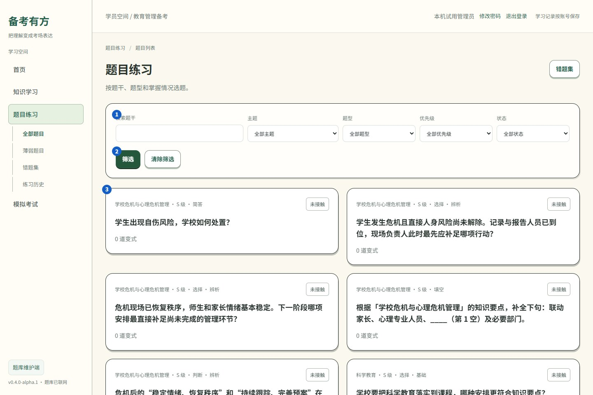

| 图中编号 | 页面元素 | 操作、状态和联动 |
| --- | --- | --- |
| 1 | 筛选条件 | 输入题干关键词，或选择主题、题型、优先级和掌握状态。 |
| 2 | 筛选操作 | 应用或清除已填条件。P05 的「开始主题自测」会直接带入当前主题。 |
| 3 | 题目与变式 | 整卡进入 P07 原题。有变式时分别显示独立入口和掌握色。 |

### 交互说明

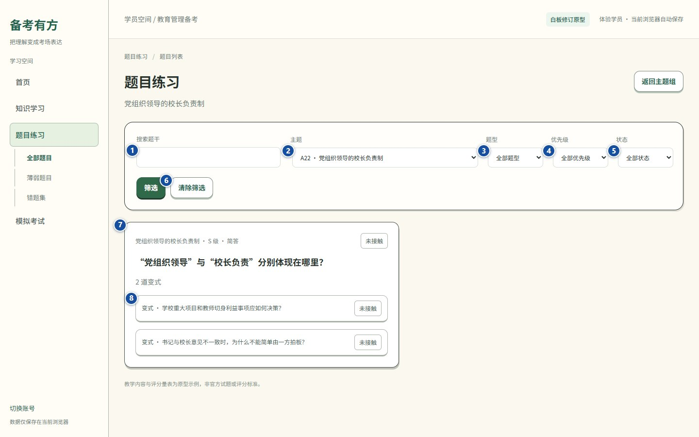

| 图中编号 | 页面元素 | 操作、状态和联动 |
| --- | --- | --- |
| 1 | 搜索题干 | 输入关键词，点击「筛选」后匹配题干或标题。 |
| 2 | 主题 | 从 P05 进入时预选主题，用户可重新选择。 |
| 3 | 题型 | 选择、判断、填空、简答四类筛选。 |
| 4 | 优先级 | 按 S / A / B 缩小范围。 |
| 5 | 掌握状态 | 按五种状态或仅看薄弱筛选。命中变式时仍展示其原题卡。 |
| 6 | 清除筛选 | 恢复全部题目。筛选无结果时提供返回全部入口。 |
| 7 | 原题卡 | 整卡点击进入 P07 原题，支持题干、元信息和空白区域。Tab 定位原题链接后按 Enter 进入，焦点框覆盖整卡。 |
| 8 | 变式行 | 单独显示变式状态，点击直达 P07 对应变式。 |

### 功能规则

- 默认展示可搜索题干的题组列表。支持按主题、题型、优先级和掌握状态筛选，支持仅看薄弱与清除筛选。知识地图使用分级目录，练习使用题目列表。
- 卡片显示题干、题型、主题、状态、最近记录和变式数。每道变式可直接打开。命中变式时保留所属题组，空结果展示调整筛选入口。
- 原题使用覆盖卡片的链接，变式链接独立位于其上层，点击变式直达对应变式。整卡采用 P04 的 `card-motion` 预设，悬停浅灰上浮、按下浅绿下压。默认底色按原有掌握状态显示，移出后恢复；变式行保留自身状态色。系统开启减少动态效果时省去位移和过渡。
- 题目列表、变式数量、薄弱统计和新生成模拟卷只读取 `contentType=question` 的内容。变式须标记 `questionRole=variant`，并通过 `parentId` 关联同主题的原题。知识解释和政策依据按各自材料引用展示。
- 原始分类修正后保留 66 道题目，加上 115 道知识卡客观题合计 181 道。知识材料仍有 18 条补充讲解、6 条待核验政策依据。选择、判断卡片及 P07 显示基础/辨析标签。
- 示例「党组织领导的校长负责制」原题保留问句，关联两道真实变式。职责定位、决策程序、实施示例等内容在 P05「展开理解」和对应题目的答后解析中查看。政策引用进入 M02 补齐来源、日期、适用范围后审核。
- 旧缓存按明确的原始编号、版本和题干进行一次性分类修正，追加修订记录。个人作答、旧答卷快照和用户编辑的草稿保留。重复刷新不重复追加。旧材料链接显示归类说明及相应知识主题入口。
- **联动** → P07 单题，P08 错题集，P05 返回主题。首页任务、知识卡和错题入口携带筛选或指定题目的上下文。

### 内容标签与引用约定

| 字段 | 含义与读取规则 |
| --- | --- |
| `contentType` | `question` 为题目，`knowledge` 为知识卡，`knowledge_explanation` 为知识讲解，`policy_basis` 为政策依据。 |
| `questionRole` | 题目专用。原题为 `original`，变式为 `variant`，与所属原题字段保持一致。 |
| `kind` | 题目的作答形式，选择、判断、填空或简答。 |
| `sourceType` | 资料来源性质，如教学编题、考生回忆；在题目类型之外单独维护。 |
| `knowledgeId` | 归属知识卡。主题中的 `questionIds` 明确列出题目引用。 |
| `explanationRefs` | 只引用同主题的知识讲解。知识卡在「展开理解」显示，题目在答后解析显示。 |
| `policyBasisRefs` | 只引用同主题的政策依据。原始政策材料为待核验状态，经过 M02 正常审核后进入学员端。 |

后续资料导入需要明确内容类型和归属引用。题库发布校验类型、原题/变式关系和材料引用的类型及主题。练习与模拟记录保存已解析的讲解快照，便于追溯当时内容。

## P07 单题提取与变式

### 正式工程

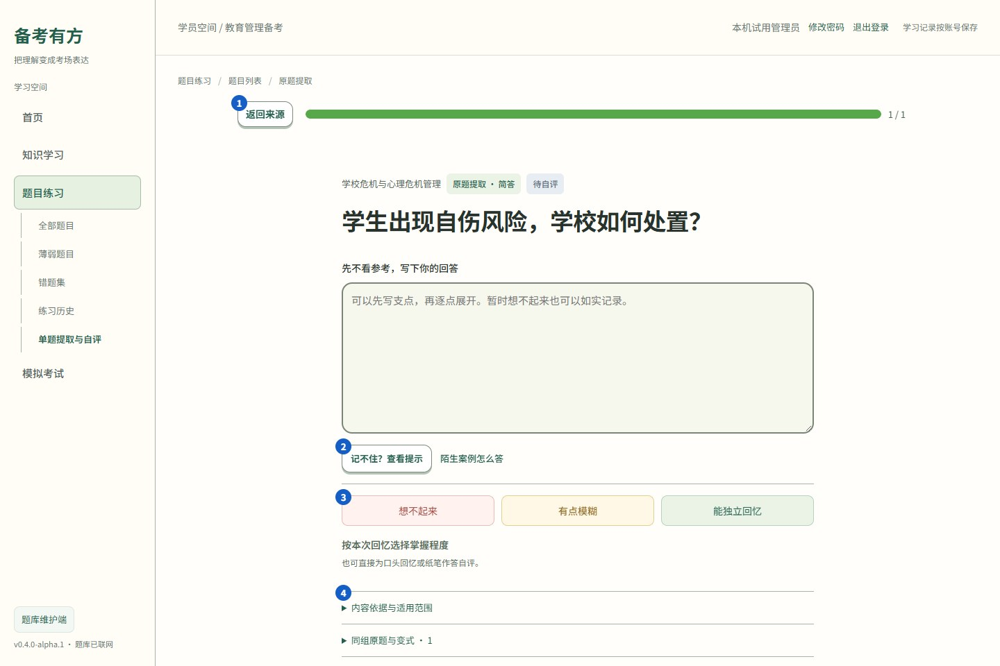

| 图中编号 | 页面元素 | 操作、状态和联动 |
| --- | --- | --- |
| 1 | 题组进度 | 显示原题和变式中的当前位置。可返回入口，也可切换同组题。 |
| 2 | 答题操作 | 简答提供逐层提示，客观题提供核对答案。案例说明从 P03 返回后可继续原题。 |
| 3 | 熟练度自评 | 可直接评估口头或纸笔回忆。自评更新 P04、P05、P06，并影响 P02 的复练。 |
| 4 | 练习详情 | 按需展开来源、同组原题与变式，以及该账号的版本化练习历史。 |

### 交互说明

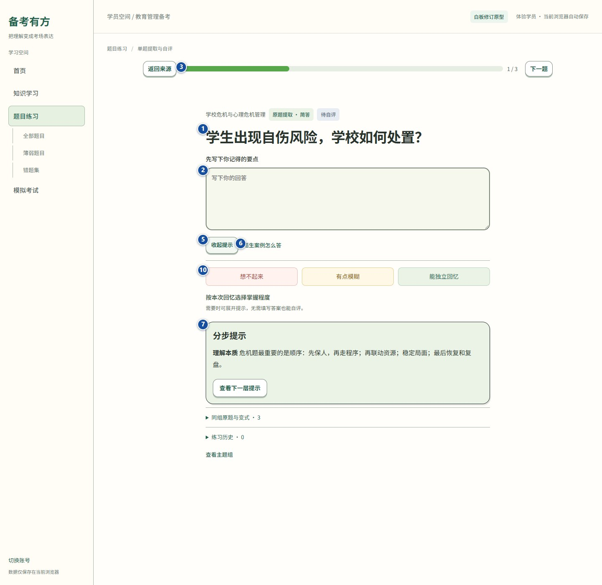

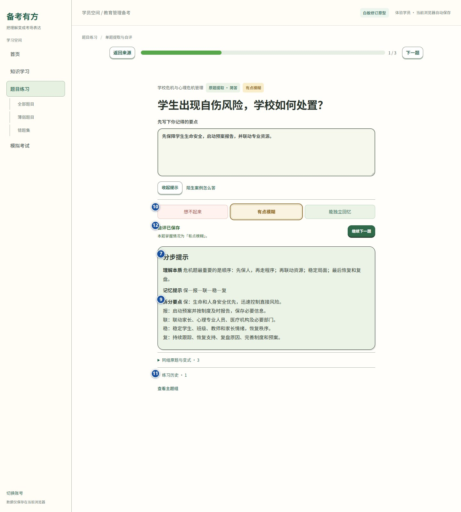

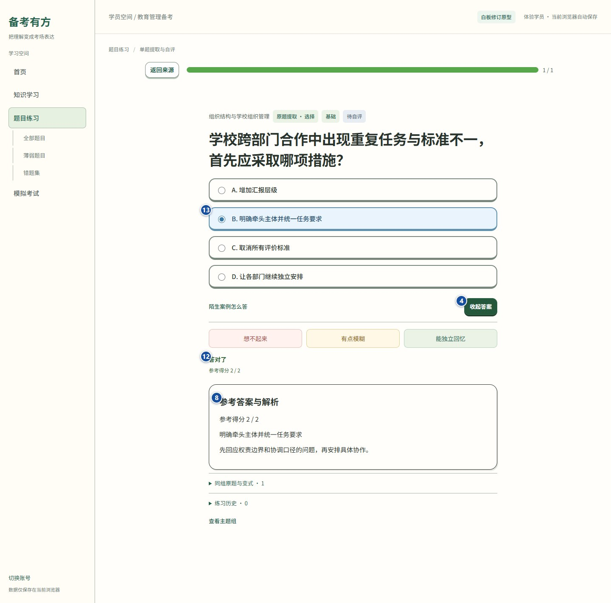

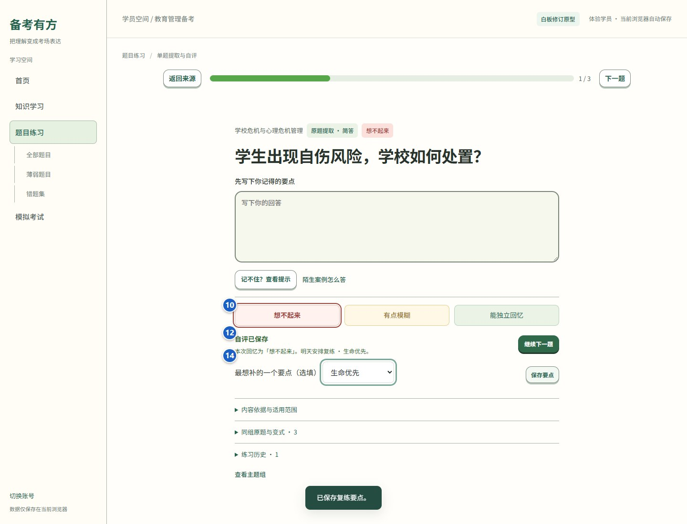

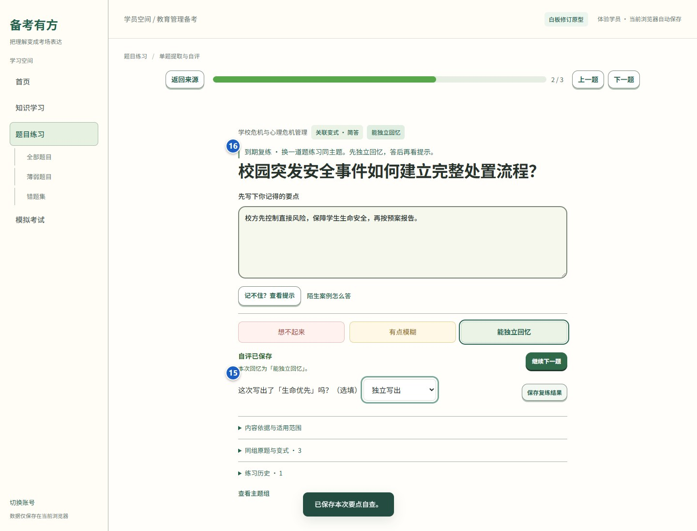

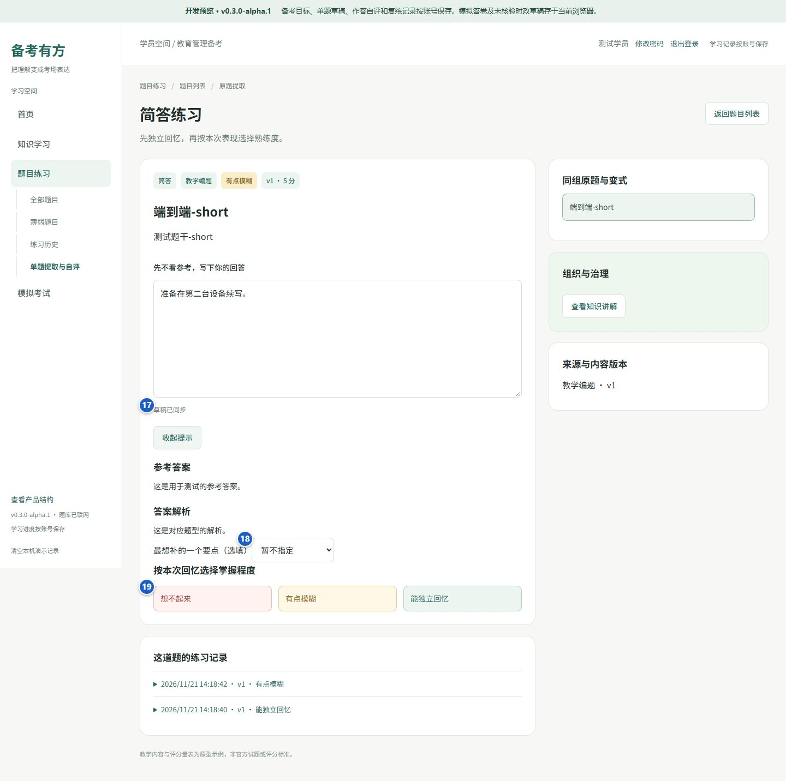

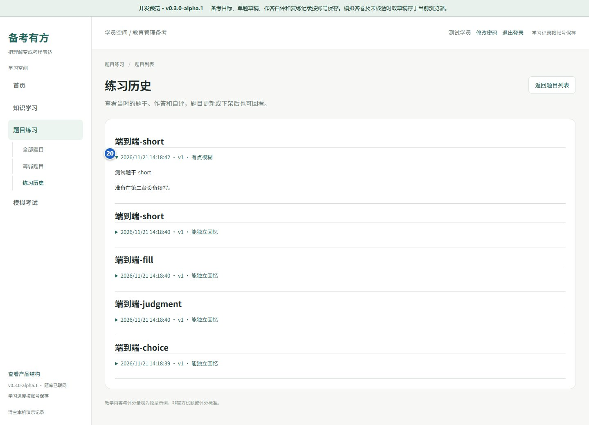

| 图中编号 | 页面元素 | 操作、状态和联动 |
| --- | --- | --- |
| 1 | 题干和位置 | 区分原题或关联变式，显示组内序号和当前掌握状态。 |
| 2 | 作答区域 | 按题型显示选项、逐空输入或多行文本。编辑写入本机草稿。 |
| 3 | 组内进度与切题 | 顶部显示当前题号和题组总数。上一题与下一题只在组内切换，各题恢复独立草稿。 |
| 4 | 客观题核对按钮 | 仅选择、判断、填空题保留「核对答案」，展开后为「收起答案」。简答提取页取消独立参考按钮与参考区，统一使用提示。 |
| 5 | 提示开关 | 简答提示默认收起，打开第一层，收起后可回到作答区重答。 |
| 6 | 案例帮助 | 进入 P03，返回时保留 P07 的题目和草稿。 |
| 7 | 分步提示 | 按本质、记忆提示、拆分要点逐层开放。简答内容只在提示中展示；最后一层可附不重复的补充解析及已审核材料。 |
| 8 | 客观题核对结果 | 有有效作答并核对后显示参考分及答案解析；空白查看答案不记 0 分。该区域不在简答页出现。 |
| 9 | 简答提示中的完整要点 | 完整要点只在第三层提示中出现一次，没有重复参考面板或逐点复选框；缺少要点数组时使用完整参考正文。 |
| 10 | 常驻掌握自评 | 在答题框下显示三档选项，不要求填写答案、展开提示或先核对。选后保存，更新 P02、P04、P05、P06；同次作答改选只修订本次记录。 |
| 11 | 练习历史 | 展开查看历次原答、参考快照和旧版草稿。 |
| 12 | 行内反馈与下一步 | 保存自评后直接显示选中的状态，并提示下次复练日期。继续组内下一题或返回来源由用户选择。 |
| 13 | 选择题选中态 | 选中的选项以蓝色边框和背景表示。核对后的客观结果与用户选择的掌握状态独立显示。 |
| 14 | 最想补的一个要点 | 简答选择「想不起来」或「有点模糊」后，可额外保存一个知识卡要点。可以跳过或清空，复练照常安排。 |
| 15 | 复练要点自查 | 已指定要点的简答复练，录入答案并自评后，可补记「独立写出」或「仍有遗漏」。结果归入本次练习历史。选择仍有遗漏且该主题还未排期时，隔 3 天再练。 |
| 16 | 到期复练说明 | 显示换题复练或重做本题。新一轮从独立的作答框开始，切页后可恢复本轮草稿。 |
| 17 | 草稿同步状态（正式工程） | 显示「作答待同步」「正在同步草稿」或「草稿已同步」。待同步时可手动保存，冲突时两份作答由用户选择。 |
| 18 | 选记复练要点（正式工程） | 简答查看参考后可选一个最想补的点，和自评一起提交。 |
| 19 | 自评提交（正式工程） | 三档自评常驻，提交后保存本次记录。留空自评不会产生客观扣分。 |
| 20 | 账号练习历史（正式工程） | 从题目练习子菜单进入，展开记录查看旧题版本、原答、自评与已保存的客观分。支持翻页回看。 |

### 功能规则

- 优先展示题干、答案控件、组内位置与上一题、下一题。原题和变式放在同一组，每题独立保留草稿、提示和自评。可回题目列表、知识卡或来源复盘。
- 单题采用聚焦布局和圆角选项。蓝色只表示选中。简答页只保留提示开关与案例帮助，取消「对照参考自评」及独立参考面板；客观题保留右侧「核对答案」。三个掌握选项始终常驻，保存状态在选项下方显示，不使用固定底栏。提示保留轻量展开过渡，减少动态效果时取消过渡。
- 选择支持单选和多选，判断为正确/错误，填空按空号，简答为文本。打开后状态为待自评。支持输入作答，也支持口头回忆、纸笔作答后直接选熟练度；提示区默认收起。
- 简答提示按「理解本质 → 记忆提示 → 拆分要点」逐级揭示，支持收起后重答。完整要点只出现一次，补充解析与已审核时政材料归入最后一层提示，沿用既有适用范围和版本校验，不另建重复参考区。客观题作答后核对答案，选择按完整选项集合、判断精确核对、填空按允许答案逐空匹配与部分计分。
- 三个掌握选项为「想不起来、有点模糊、能独立回忆」，无需输入或查看提示即可选择。简答直接自评及未核对的客观题自评记录 `evaluationMode=self-only`、`score=null`，不伪造客观 0 分或满分；客观题有有效作答并核对后记录 `checked-self`，按真实答案计算分数。
- 每次自评保留日期、题目版本、实际输入和题目参考快照，历史可标注「直接自评」。同次作答改选熟练度或补看参考更新同一条记录；修改答案后开启新的本次自评，不覆盖旧作答。旧历史中的逐点勾选字段仅保留，不再编辑。客观错答按分数进入错题集，直接自评的想不起来/有点模糊按薄弱状态收录，空白自评为能独立回忆时不制造错题。掌握状态仍由用户选择。
- 历史可查看原答和旧题快照。新版题保留旧记录，掌握需重新确认。
- 「想不起来」默认隔 1 天，「有点模糊」默认隔 3 天。同次作答改选只调整本次生成的安排。一次「能独立回忆」保留为自评结果；从到期任务入口完成本次自评后关闭这一轮。尚有困难时继续安排下一轮。同一主题仅保留一个待复练任务，已有的安排可继续使用。
- 到期进入优先选同一要点的同题型练习或同组变式，缺少时尝试同主题练习或重做来源题。作答前只提示复练类型，且不回填旧题草稿；本次草稿单独保存。有实际文字作答时，用户可对照原先选的要点记录「独立写出」或「仍有遗漏」，历史显示自查结果。展开「内容依据与适用范围」可查看题目类型、版本和知识卡来源，未核验的考纲范围与核验日期明确待定。
- **联动** → P02 今日任务、P04/P05 进度、P08 错题、P09 选题、P03 案例帮助、P13 复盘。题目练习结束后由用户选择下一步。

**正式工程。** 草稿按账号、题目版本和是否从到期复练进入区分存储。用户可在保存自评前选记要点；保存后从「练习历史」回看提交当时的作答。旧服务器草稿与本机旧记录可分别查看。原型保留同次作答改选能力；正式工程一次提交生成一条固定记录，重新进入练习可再次自评。

## P08 错题集

### 正式工程

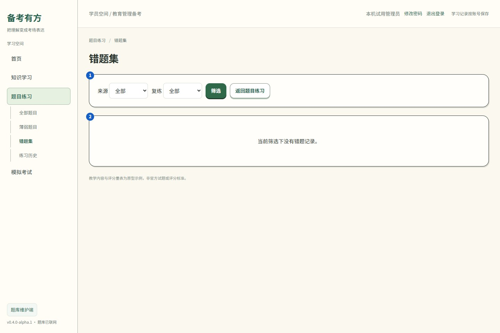

| 图中编号 | 页面元素 | 操作、状态和联动 |
| --- | --- | --- |
| 1 | 筛选 | 按练习、模拟或复练状态筛选当前账号的记录。 |
| 2 | 结果 | 同题同来源汇总条数。卡片可进入 P07 原题或同主题复练，也可回到 P13 原答卷或练习历史。 |

本机试用版根据账号的复练任务完成记录显示已复练。原型中的手动切换和逐卡展开完整历史仍是待对齐的交互。

### 交互说明

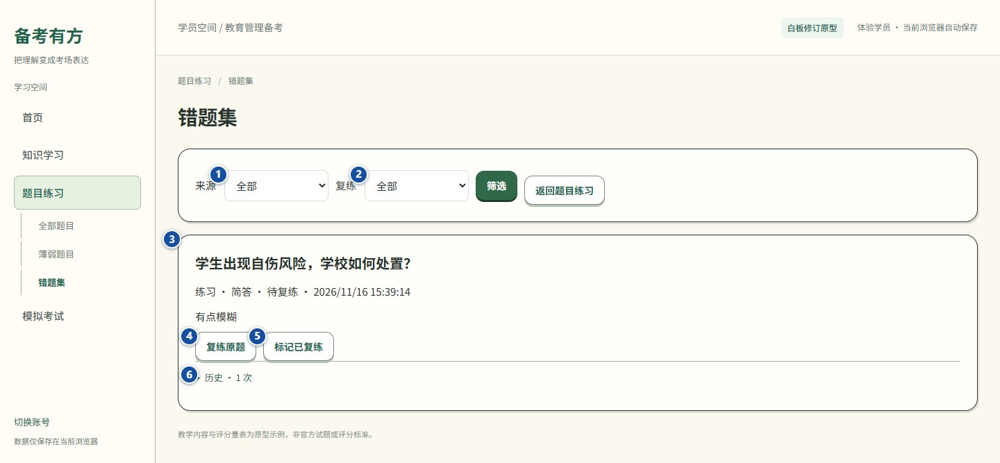

| 图中编号 | 页面元素 | 操作、状态和联动 |
| --- | --- | --- |
| 1 | 来源筛选 | 选择全部、练习或模拟。 |
| 2 | 复练筛选 | 选择待复练或已复练，再点击「筛选」。 |
| 3 | 错题卡 | 展示题干、收录来源、原因和最近时间。无匹配时显示空状态。 |
| 4 | 复练 | 进入 P07 原题，模拟专用题可进入同主题的练习题。 |
| 5 | 复练状态 | 手动标记已复练或标回待复练。再次出现新错误时回到待复练。 |
| 6 | 历史 | 展开同来源同题的历次记录，从模拟记录可跳回 P13。 |

### 功能规则

- 汇总已核对的客观错答、部分正确，以及完成自评的薄弱题。模拟卷在确定某题低于满分后也进入。条目显示来源、题型、答错或薄弱原因、最近时间、历史及原题入口。
- 支持按练习/模拟及待复练/已复练筛选，手动标记已复练。重复命中同一来源的同一题聚合事件，保留历史。新一次错误会重新变为待复练。
- **联动** → P07 重新作答，P13 回看原卷，P04 进度只依据独立自评。P09 可用待复练状态提高选题优先级。

## P09 模拟试卷库

### 正式工程

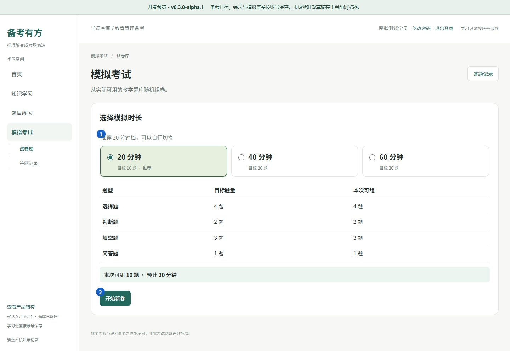

| 图中编号 | 页面元素 | 操作、状态和联动 |
| --- | --- | --- |
| 1 | 三档模拟时长 | 显示推荐档、目标题数和本次可用题量。题池不足时按可用题量组卷。 |
| 2 | 开始新卷 | 固定本卷题目及评分依据。已有草稿时提供续答，另开一套须确认替换。 |

### 交互说明

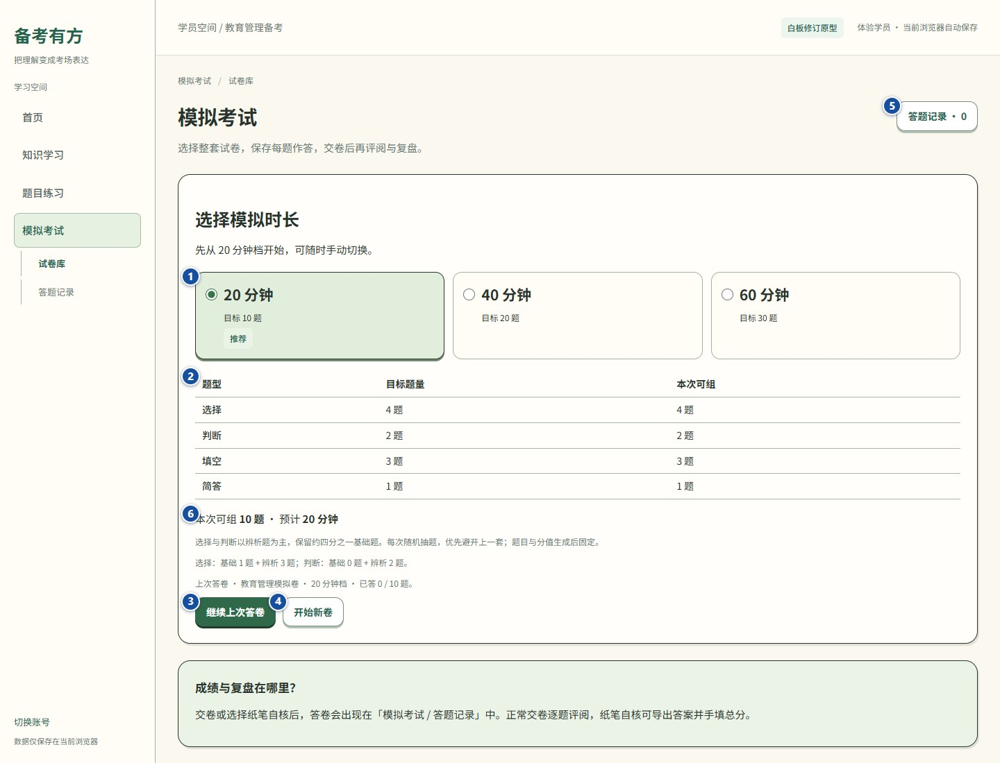

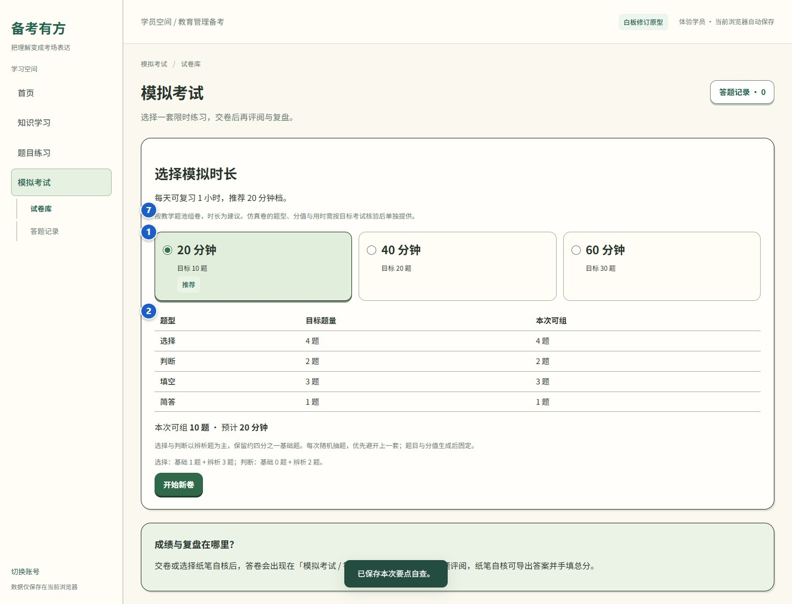

| 图中编号 | 页面元素 | 操作、状态和联动 |
| --- | --- | --- |
| 1 | 时长档位 | 20、40、60 分钟三档，读取 P02 每日复习时长标出推荐档，可手动切换。 |
| 2 | 题型分布 | 同时展示各题型的目标与本次可组数量，并显示实际预计用时。 |
| 3 | 续答 | 有未交稿时出现，进入 P10 并恢复题号、原答及附件。 |
| 4 | 开始新卷 | 从 M01 模拟池生成独立快照。有草稿时先确认替换。 |
| 5 | 答题记录 | 进入 P12，包含正常交卷与已看答案的纸笔自核记录，进行中草稿不计入。 |
| 6 | 实际题量与用时 | 显示去重后本次可组题数和预计用时，题池不足时提示缺额。 |
| 7 | 试卷用途 | 20／40／60 分钟为教学题池的限时练习；仿真卷须另按目标考试核验题型、分值及用时。 |

### 功能规则

- 每日复习不足 2 小时推荐 20 分钟档，2 至不足 3 小时推荐 40 分钟档，3 小时及以上推荐 60 分钟档。未设置目标时默认推荐 20 分钟。用户可手动选择任意档位。
- 配比由选择、判断、填空、简答构成。20 分钟目标为 4、2、3、1 题，共 10 题；40 分钟为 8、4、6、2 题，共 20 题；60 分钟为 12、6、9、3 题，共 30 题。选择与填空合计占题数 70%，简答占 10%。
- 选择、判断各自控制难度：基础数量为该题型目标数除以 4 后向下取整，其余为辨析。20 分钟选择 1 基础 + 3 辨析、判断 0 + 2；40 分钟选择 2 + 6、判断 1 + 3；60 分钟选择 3 + 9、判断 1 + 5。组内随机排序，不把简单题固定在第一题。特定难度不足时用另一难度补足，并提示实际池不足；不宣称补足后仍满足比例。
- 预计用时暂按选择 1 分钟、判断 1 分钟、填空 2 分钟、简答 8 分钟估算。分值沿用题库内容。本原型用时为建议值，供后续调整。
- 候选只取已发布、类型正确且允许模拟的题目，按题型配额抽取。每次开始新卷时随机抽取，优先避开上一套、少抽已做较多的题，再考虑待复练题。同卷按题号和同题型的相同题干去重。
- 题池不足时按该题型实际数量生成，并展示缺额和实际预计时长。当前有效池为选择 48、判断 47、填空 24、简答 60 题，可组满三档并满足难度配额。无可用题时禁用开始。旧草稿维持原题量和难度，不自动补题。
- 同一账号保留一份进行中答卷。新卷固定时长档、预计用时、题干、答案、分值、量表和解析快照。浏览页面及打印沿用该套快照。开始新卷前确认替换旧草稿，已交卷记录保留。选题记录按账号保存，用于下一次避重复。
- **联动** → P02 时间预算、P07 练习覆盖、P08 待复练题、M01 模拟池、P10 作答、P12 记录。

## P10 模拟作答

### 正式工程

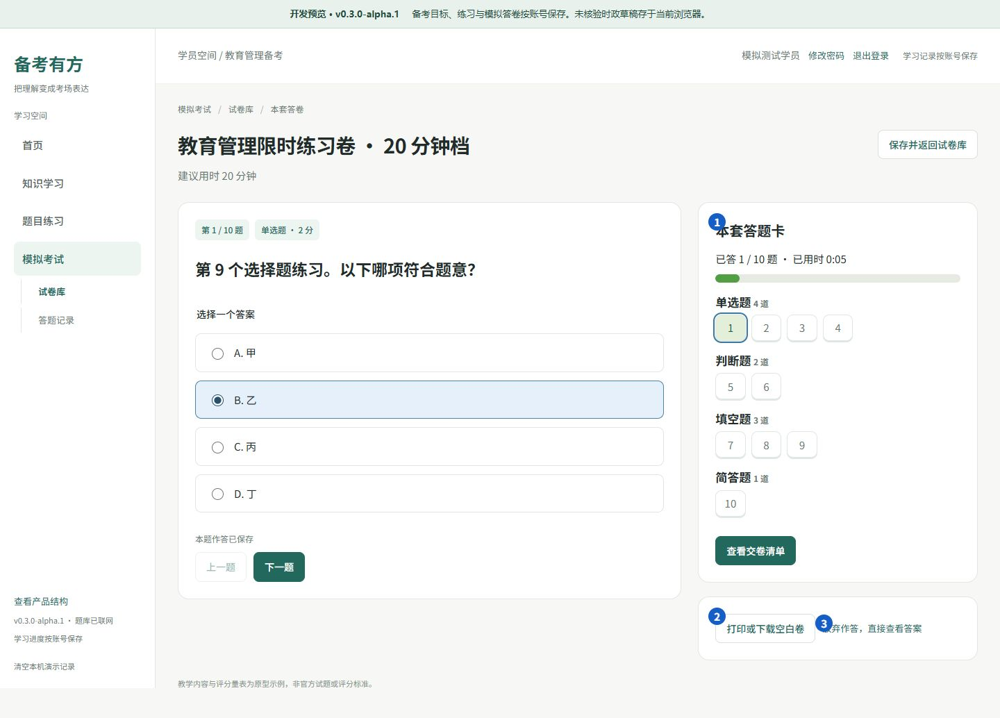

| 图中编号 | 页面元素 | 操作、状态和联动 |
| --- | --- | --- |
| 1 | 答题卡 | 按实际题型分组，显示当前题、已答状态和用时，点击题号切换并保存位置。 |
| 2 | 打印空白卷 | 先保存当前草稿，再进入 P14。返回时恢复题号。 |
| 3 | 直接查看答案 | 确认后结束在线作答，形成可回看的纸笔自核记录。试用版纸笔流程采用打印、看答案和手填总分。 |

### 交互说明

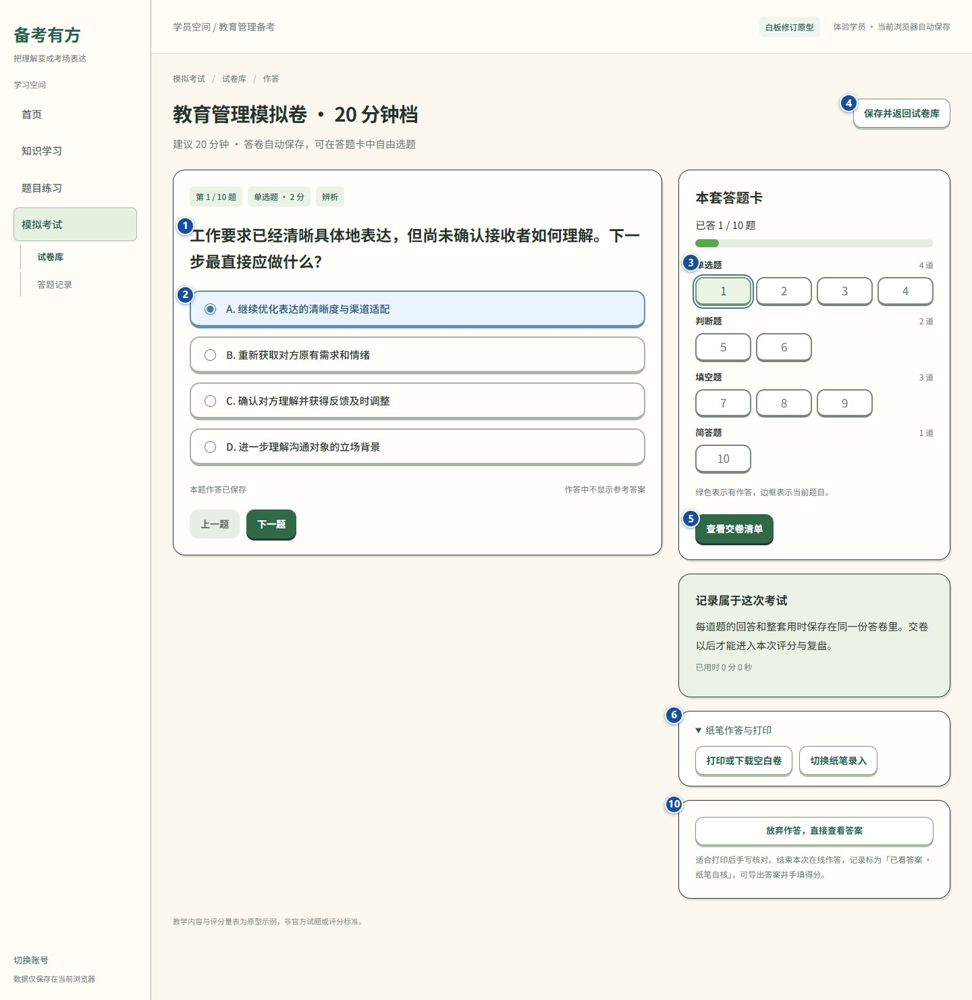

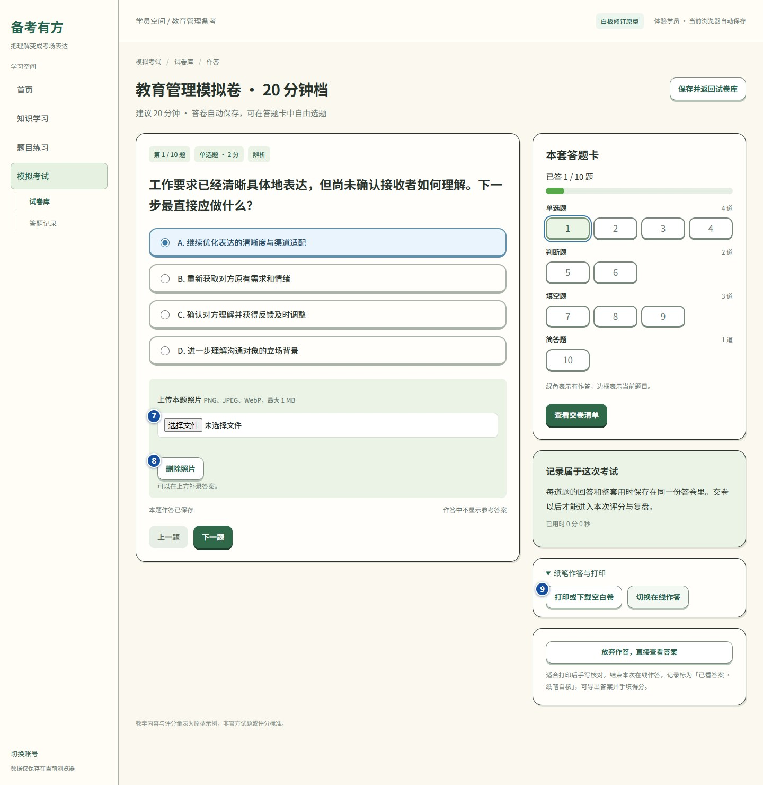

| 图中编号 | 页面元素 | 操作、状态和联动 |
| --- | --- | --- |
| 1 | 题干和分值 | 显示当前题、总题数、题型及分值。 |
| 2 | 作答控件 | 蓝色表示当前选择，输入后自动保存。作答阶段隐藏参考答案。 |
| 3 | 答题卡 | 按规范题型分组，每组只显示一次题型与实际题数，组内只显示题号。点击题号自由切换，进度条同步，蓝色边框表示当前题，绿色背景表示已作答。 |
| 4 | 保存并返回试卷库 | 回 P09 保留未交稿，从「继续上次答卷」回到当前位置。 |
| 5 | 查看交卷清单 | 进入 P11。可从清单返回继续修改。 |
| 6 | 纸笔作答与打印 | 展开答题卡下方工具，可切换纸笔录入或进入 P14。 |
| 7 | 本题照片 | 按题上传或替换 PNG、JPEG、WebP，单张不超过 1 MB。可同时补录文字。 |
| 8 | 删除照片 | 只移除当前题附件，已填文字继续保留。 |
| 9 | 打印空白卷 | 进入 P14 当前试卷快照，打印或下载后仍可继续 P10。 |
| 10 | 放弃作答，直接查看答案 | 常驻工具按钮。确认结束本次在线作答，生成同 ID 的纸笔自核记录并进入 P13 答案模式；取消则继续作答。 |

### 功能规则

- 展示题号、题干、类型、分值、计时与答题卡。作答自动保存。答题卡区分当前题、已答和未答，上一题/下一题与点击题号都能切换。允许保存返回试卷库。
- 新卷按选择、判断、填空、简答排序并连续编号，与打印卷对应。页面显示本套实际预计用时。已有旧答卷缺少时长字段时，沿用旧版每题 6 分钟的显示规则。
- 显示名称由 `kind` 和 `multiple` 统一派生为单选题、多选题、判断题、填空题、简答题；已有论述保留论述题名称。旧数据中的「选择」「单选」不再拆成两类。分组数量从当前答卷快照计算，不用目标题量替代实际题量。
- 支持在线输入，也可打印后手写。纸笔答卷可在相应题上传照片、预览、替换和删除。拍照上传后可手动补录文字；只提供图片时人工核对，不从图片推断答案。
- 作答阶段隐藏参考答案。纸笔附件按答卷和题号归属，原型在本机保存图片。
- 「放弃作答，直接查看答案」允许没有线上答案时使用，方便已打印的纸笔用户。确认后记录 `completionMode=answer-only` 与查看时间，保留已有文字和图片，清除进行中草稿；答案一经查看不再恢复为未看答案的在线考试。按答卷 ID 防重复创建。
- 这类记录不把空题计 0，不自动判断逐题对错，不进入错题统计。进入 P13 可看全部答案和原卷评分要点，导出 P14 答案，手填原卷总分。正常交卷仍走 P11 的原规则。
- **联动** → P14 空白卷打印/下载、P11 确认、P09 继续草稿。

## P11 交卷确认

### 正式工程

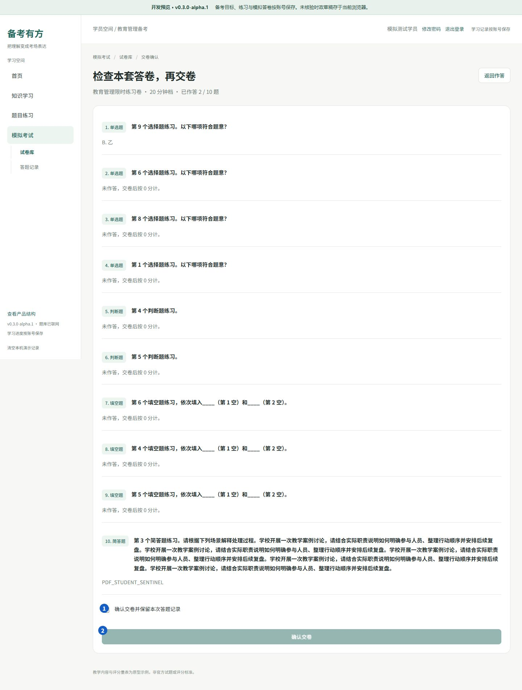

| 图中编号 | 页面元素 | 操作、状态和联动 |
| --- | --- | --- |
| 1 | 交卷确认 | 核对原答与空题，退回可继续修改。至少作答一题且勾选后才可在线提交。 |
| 2 | 确认交卷 | 服务器固定原答，返回本次复盘。重复提交沿用同一记录。 |

### 交互说明

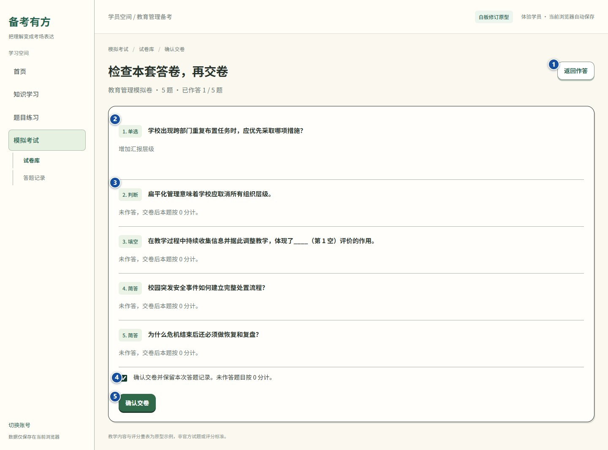

| 图中编号 | 页面元素 | 操作、状态和联动 |
| --- | --- | --- |
| 1 | 返回作答 | 回 P10，保留答案、照片和当前作答位置。 |
| 2 | 已答清单项 | 展示原答或照片，便于核对。 |
| 3 | 未答清单项 | 提示未作答题交卷后按 0 分计。 |
| 4 | 确认勾选 | 必须勾选，并且至少一题有文字答案或照片。 |
| 5 | 确认交卷 | 满足条件后可点。生成一条 P12 记录，并打开该次 P13 复盘。 |

### 功能规则

- 展示整卷每题原答、照片、已答数量及未答提示。支持返回继续作答。必须至少回答一题或附一张答题照片，并显式确认后才可交卷。空题计 0 分。
- 提交冻结原答、快照和图片，记录开始、交卷时间和用时。重复提交应回到同一结果，正式服务需提供幂等提交。
- **联动** → P13 本次评阅，同时在 P12 新增记录。

## P12 答题记录

### 正式工程

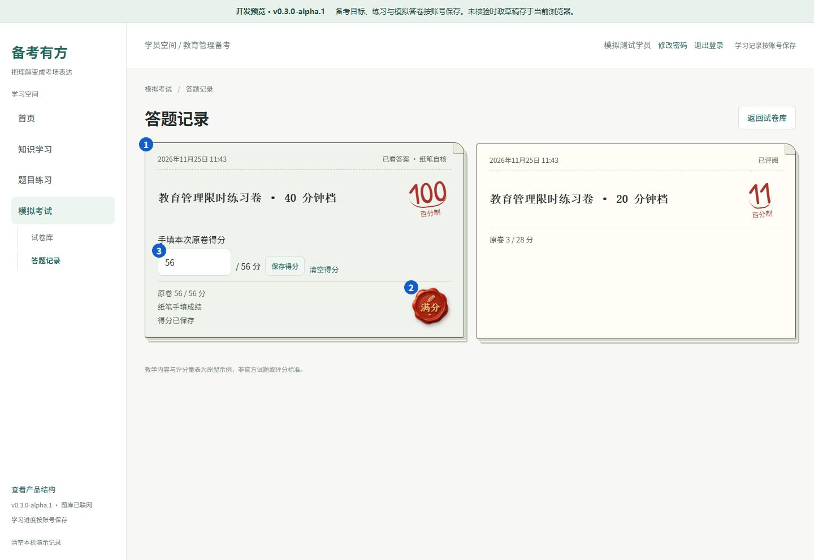

| 图中编号 | 页面元素 | 操作、状态和联动 |
| --- | --- | --- |
| 1 | 纸质答卷卡 | 整卡可进入对应 P13，纸笔自核与在线卷分别标记。 |
| 2 | 手写分与满分章 | 使用手写百分制及原卷原始分，原始分实得满分时显示火漆章。 |
| 3 | 手填本次原卷得分 | 在卡片录入、保存或清除纸笔总分，表单操作留在答题记录页。 |

### 交互说明

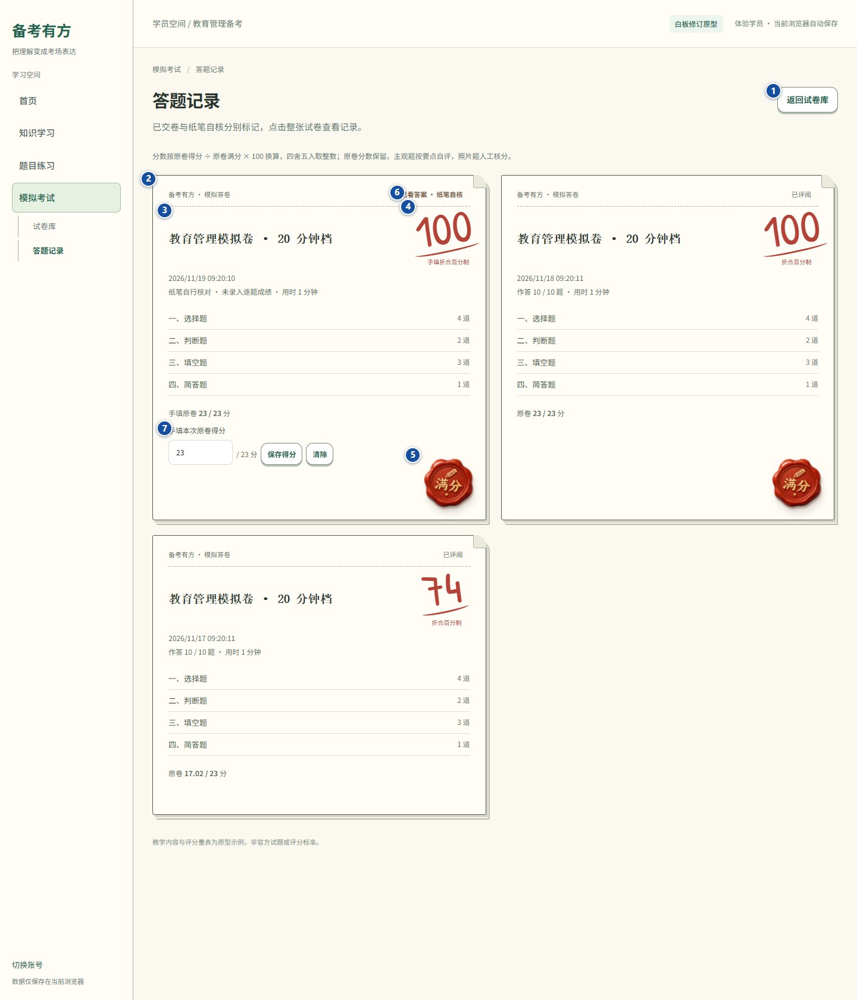

| 图中编号 | 页面元素 | 操作、状态和联动 |
| --- | --- | --- |
| 1 | 返回试卷库 | 回 P09 查看推荐卷或未交草稿。 |
| 2 | 纸质答卷卡 | 暖白试卷纸、墨线、折角与叠纸阴影，按交卷时间倒序显示卷名、日期、作答数、用时和实际题型数量。 |
| 3 | 整卡链接 | 点击标题、题型行或留白均按答卷 ID 进入 P13。移除底部专门绿色入口文字，支持 Tab/Enter，复用浅灰悬停、按压动效。 |
| 4 | 手写参考分 | 已评完时在右上角用朱红色手写数字展示百分制整数，卡片下方保留原卷得分/满分。待评时只显示待评阅。 |
| 5 | 原卷满分纪念章 | 原始得分等于原始满分时，卡片右下角显示文具铅笔主题火漆章。不是入口，不遮挡复盘链接。 |
| 6 | 纸笔自核标记 | 显示「已看答案 · 纸笔自核」，手填成绩旁标注来源，不伪装成已逐题评阅。 |
| 7 | 手填原卷得分 | 纸笔自核卡可填写 0 至原卷满分的分数，保存后刷新换算成绩；清除可恢复待手填状态。输入、保存、清除操作不触发整卡跳转。 |

### 功能规则

- 展示正常交卷与放弃在线后查看答案的实际记录，按完成时间倒序。纸笔自核显示「未录入逐题成绩」而非把纸笔答案视为未作答；手填总分保存于 `manualScore.raw/at/source`，来源为 self-reported，不覆盖原始答案或逐题评分。无记录不创建演示答卷。
- 纸张用暖白底、细墨线、浅绿灰叠纸边缘与右上折角构成，正文为常规字体，右上评分数字使用本地内置 [Patrick Hand](https://github.com/google/fonts/tree/main/ofl/patrickhand) 手写字体和朱红色批改线。字体及 OFL 许可证一并打包，离线打开无需远程字体服务。
- 百分制参考分 = `Math.round(原始得分 / 原始满分 × 100)`；保留整数，同时显示原始得分和满分，不改写 P13 原始评分。正常答卷还有待评题时不换算总分、不显示满分章；纸笔自核仅依据明确填写的总分显示，保留手填标记。
- 满分章仅在原始满分大于 0 且原始得分等于满分时出现。99.6/100 展示 100 但不获章；8/8 展示 100 且获章。图章使用原创生成的透明底立体火漆素材，包含铅笔与满分浮雕、厚蜡边缘、高光和投影，素材及生成提示词见[图章说明](../prototypes/whiteboard/full-marks-seal-v2.md)。纸笔手填满分也可获章，但卡片和替代文字明确为手填成绩。改分或清除后重新计算章的状态。
- 每次作答使用独立 ID，重复完成同类型试卷也能分别查看。原型按演示账号隔离，正式实现按会话归属隔离。
- **联动** → P13 查看对应答卷、P09 再开一卷。

## P13 本次答卷评阅与复盘

### 正式工程

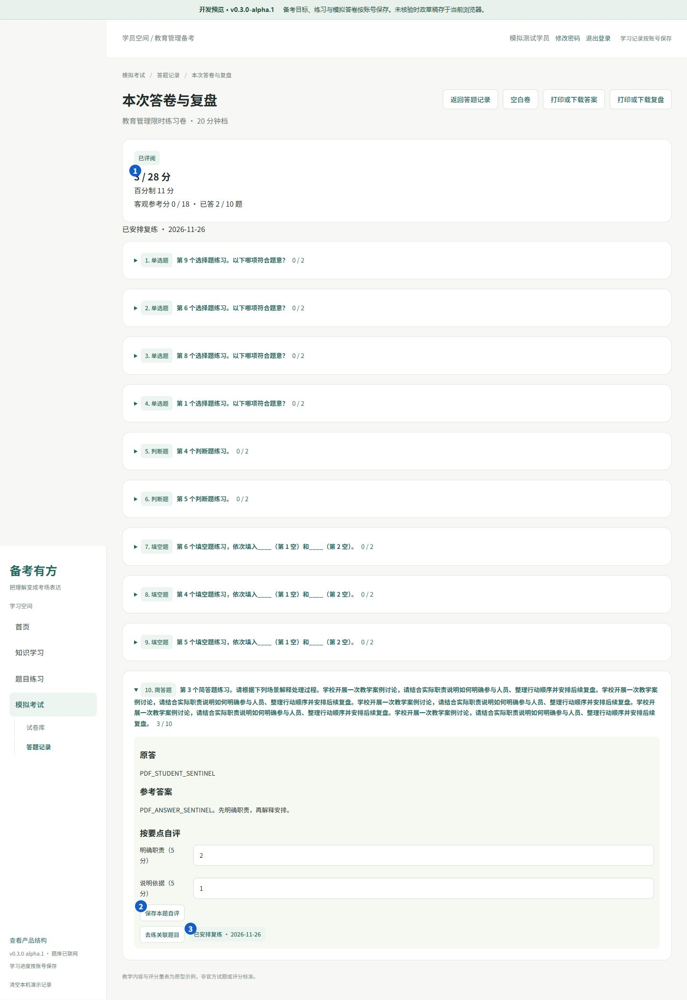

| 图中编号 | 页面元素 | 操作、状态和联动 |
| --- | --- | --- |
| 1 | 参考成绩 | 未评完的简答显示待评，完成后展示原始分及整数百分制。 |
| 2 | 保存本题自评 | 按开卷时的量表逐点评分，可先保存部分结果。 |
| 3 | 安排复练 | 可选有原答且已评分的失分题安排次日复练，回 P02 可见。 |

### 交互说明

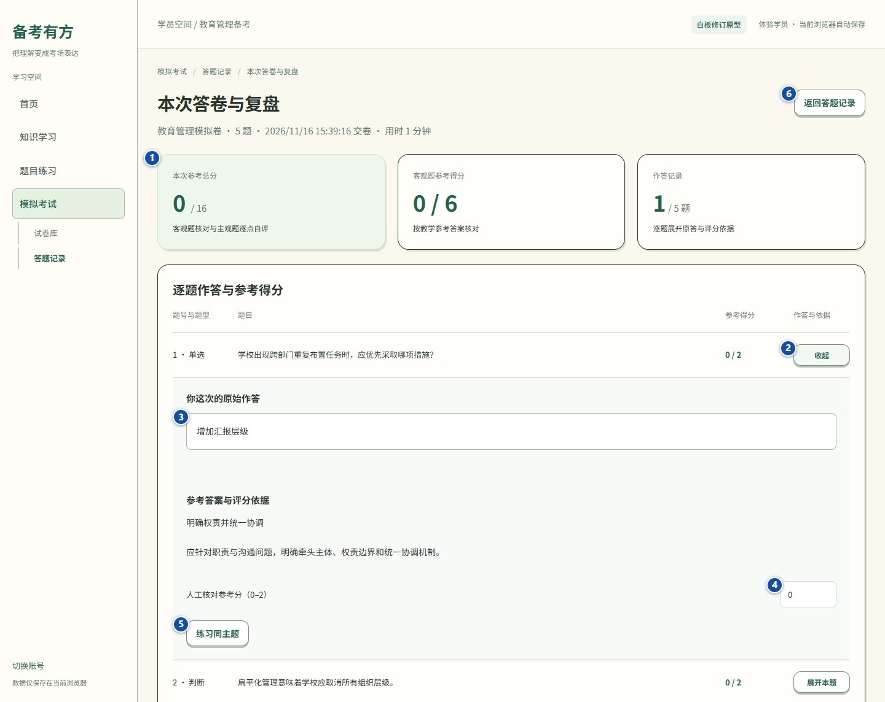

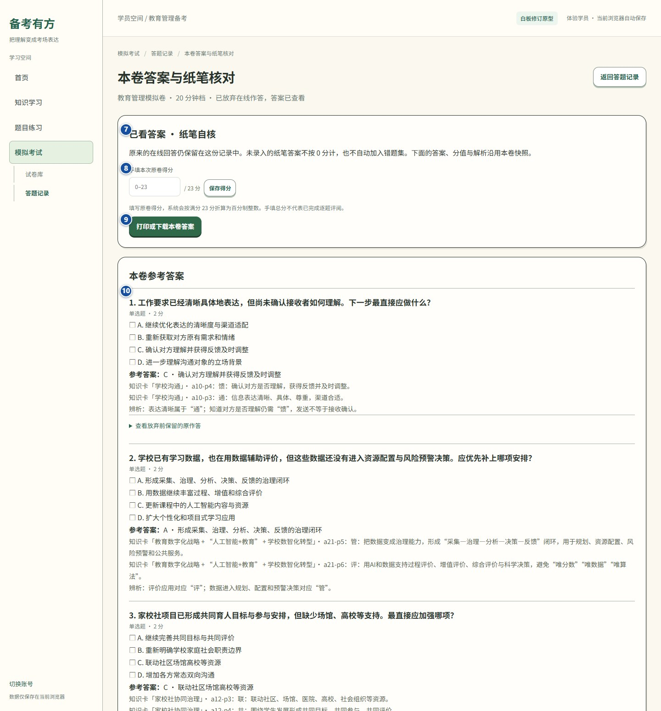

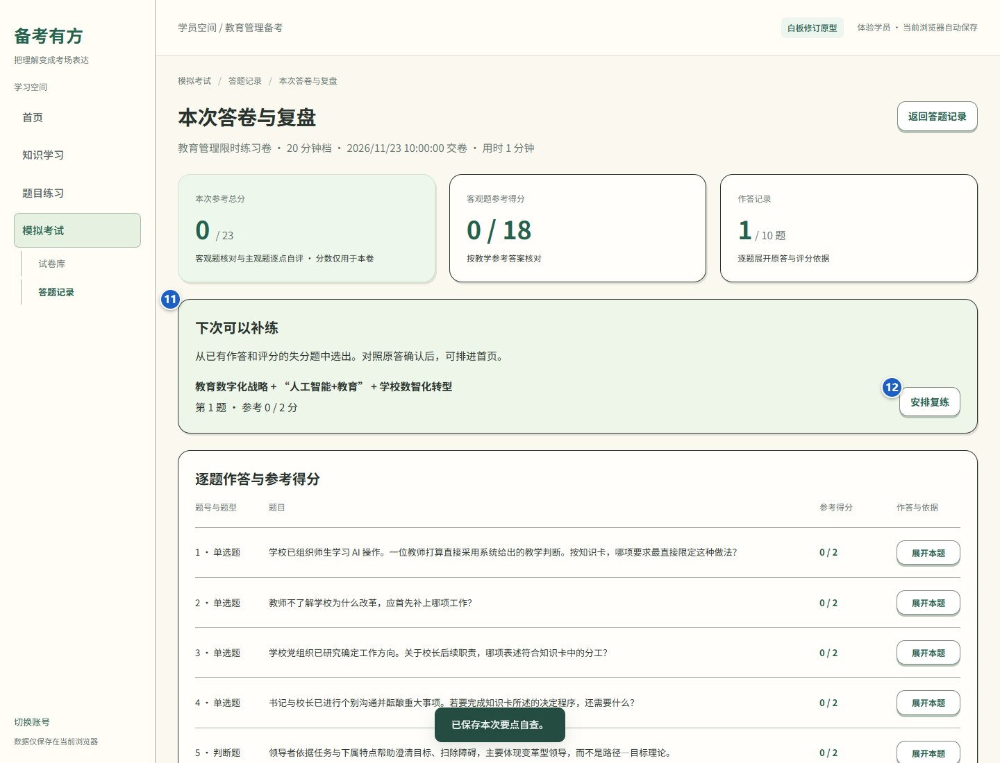

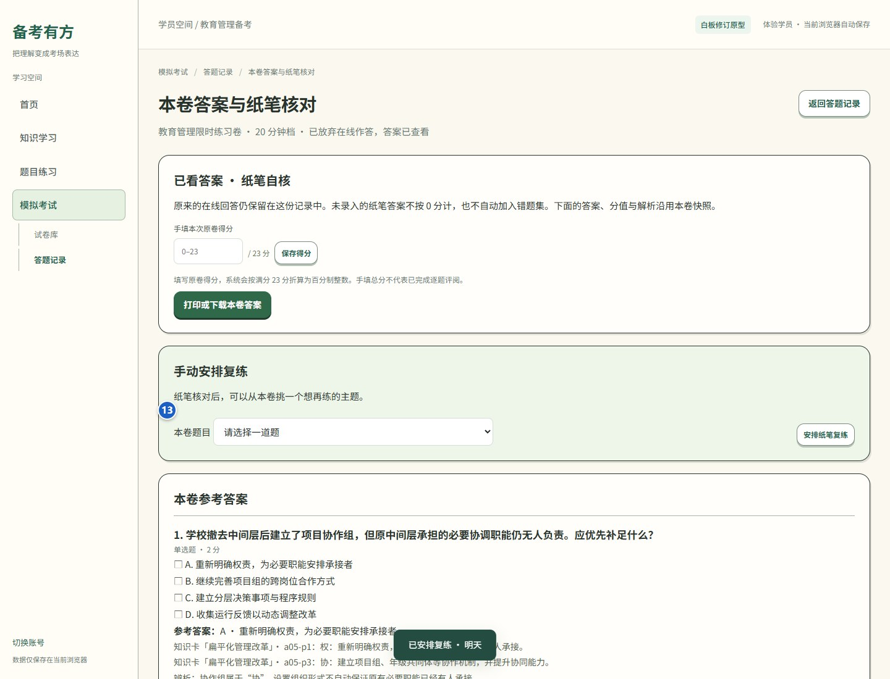

| 图中编号 | 页面元素 | 操作、状态和联动 |
| --- | --- | --- |
| 1 | 成绩概览 | 显示参考总分、客观参考分和已答数。仍有待评项时整卷总分待评。 |
| 2 | 展开本题 | 查看该题原答、照片、参考答案和评分依据。 |
| 3 | 原作答与依据 | 读取这次交卷保存的快照，供人工对照。 |
| 4 | 参考分录入 | 客观题允许人工核分，主观题逐点评分。更新 P12 的参考结果和 P08 的错题收录。 |
| 5 | 关联练习 | 打开 P07 原题或同主题题目，允许从题目返回该次复盘。 |
| 6 | 返回答题记录 | 回 P12。已保存的评阅结果仍在同一条答卷记录上。 |
| 7 | 纸笔自核说明 | 答案模式展示已看答案状态，说明不从未录入作答推断逐题对错。 |
| 8 | 纸笔手填总分 | 与 P12 同一份手填成绩，可保存和清除，不冒充逐点评分。 |
| 9 | 导出本卷答案 | 进入 P14 答案模板，包含本卷题目、正确答案、解析和主观评分要点。 |
| 10 | 全部参考答案 | 答案模式直接展开，按原卷题号顺序显示；已有线上原答可单独展开查看。 |
| 11 | 下次可以补练 | 按原卷顺序提炼至多两个有实际作答、已评分且失分的不同主题。显示题号和本题参考分；留白和待评分题不进入建议。 |
| 12 | 安排复练 | 点击后默认安排次日复练，回 P02 可见。已有同主题安排时显示日期，避免重复。 |
| 13 | 手动安排纸笔复练 | 从本卷选题并安排其主题。只填写纸笔总分不自动推断任何复练项。 |

### 功能规则

- 总览显示客观参考分、作答题数、整卷参考总分或待评阅。逐题展开原答、照片、参考答案、分值及评分依据。
- 文本客观题按规则自动核对，用户可在分值范围内人工修订。仅照片的客观题按参考答案人工核分。主观题按量表逐点自评，每点评完才得出该题分数。整卷存在待评题时暂不合计总分。
- 分数修改更新该次记录和错题集，保留原答。已评低分题可回关联题目或用其他同主题题复练。
- 复练须由用户主动安排。复盘参考分仅用于本卷，随机试卷间的百分制分数缺少统一难度口径。
- 纸笔自核记录采用单独答案模式，不显示正常逐题评阅表，不把缺失答案计为 0。手填仅记录总分，不据此推断单题对错或加入错题集。答案与解析从该答卷快照读取，不随题库修订改变。
- **联动** → P12 成绩状态、P08 收录错题、P02 复练排期、P07 作答、P14 打印/下载答卷。

**正式工程。** 本期模拟样卷仍由浏览器保存，P13 发起账号复练的能力跟随服务器答卷接入。账号的单题复练由 P07 自评安排。

## P14 打印与下载

### 正式工程

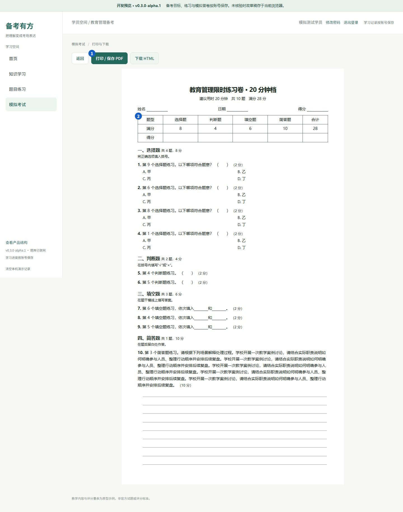

| 图中编号 | 页面元素 | 操作、状态和联动 |
| --- | --- | --- |
| 1 | 打印／保存 PDF | 四种模板均使用浏览器 A4 打印，同时提供独立 HTML。 |
| 2 | 试卷分区计分表 | 按本卷实际题型、题数和分值排版，空白卷保留答题空间。 |

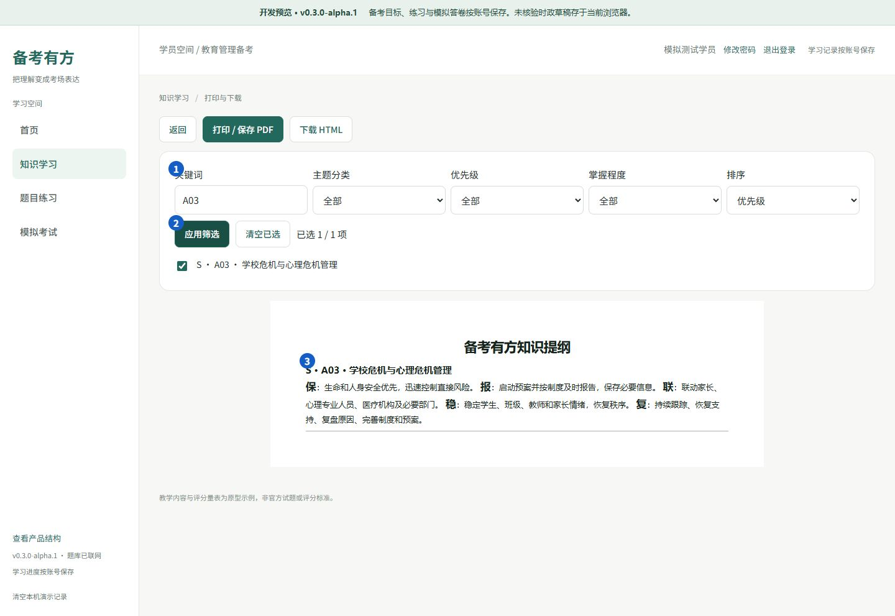

| 图中编号 | 页面元素 | 操作、状态和联动 |
| --- | --- | --- |
| 1 | 知识筛选 | 宽屏单行展示关键词、主题分类、优先级、掌握度及排序。 |
| 2 | 应用筛选 | 一次勾选全部匹配项，支持清空和逐卡取消。 |
| 3 | 紧凑知识提纲 | 每张知识卡以完整段落连续排版，速记字突出，正文自然换行。 |

### 交互说明

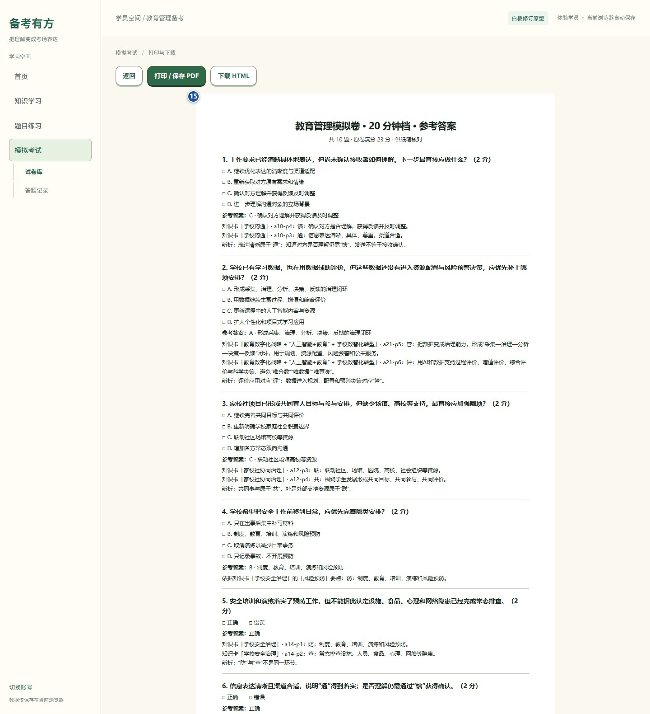

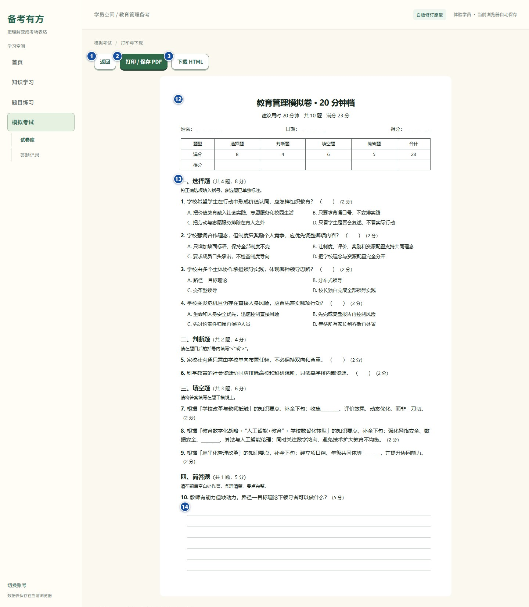

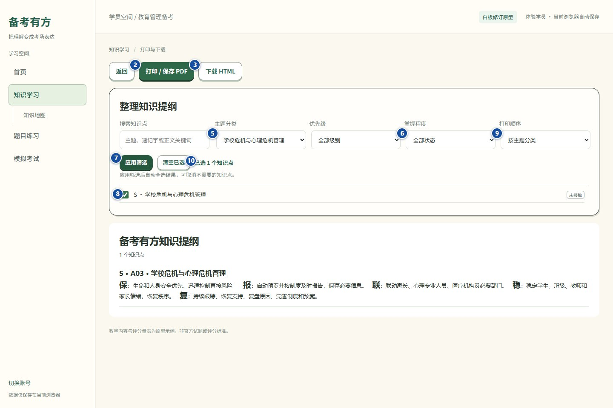

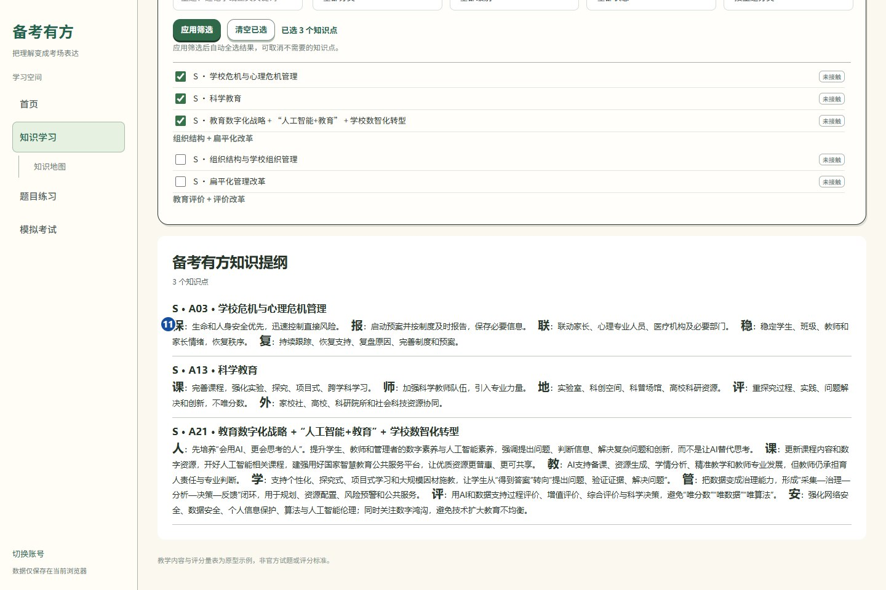

| 图中编号 | 页面元素 | 操作、状态和联动 |
| --- | --- | --- |
| 1 | 返回 | 返回来源页面，空白试卷回 P10，复盘模板回 P13，知识提纲回 P04。 |
| 2 | 打印 / 保存 PDF | 打开浏览器打印对话框，可选打印机或保存 PDF。知识提纲没有勾选内容时禁用。 |
| 3 | 下载 HTML | 保存当前版式的独立 HTML，包含全部已选知识点的完整正文和对应样式。 |
| 4 | 模板内容 | 空白卷、答案、知识提纲与复盘各有对应模板。知识提纲使用完整正文，复盘包含原答、照片及参考得分。 |
| 5 | 知识筛选 | 关键词、主题分类、优先级、掌握程度、打印顺序五个框在宽屏同排。点击「应用筛选」后自动勾选全部匹配知识点并更新预览。 |
| 6 | 掌握程度 | 「仅看薄弱」包含想不起来、有点模糊的主题，也可筛选未接触、待自评等状态。掌握数据沿用 P05 的主题状态。 |
| 7 | 应用筛选和清空 | 位于筛选框下一行。应用筛选后以全部匹配结果替换已选内容。「清空已选」清除所有选择并保留筛选条件。 |
| 8 | 完整知识点勾选 | 每条知识点为一个完整主题卡，包含全部速记段与原文解释。应用后可逐条取消，也可重新勾选。 |
| 9 | 打印顺序 | 支持主题分类、S/A/B 优先级、薄弱优先、标题排序。「应用筛选」后预览按所选顺序排列。 |
| 10 | 已选统计 | 显示已选完整知识点数量。手动增减选择时同步更新预览。 |
| 11 | 紧凑知识预览 | 第一行为优先级、主题号和标题，下一段连续展示全部速记段原文。速记字放大加粗，正文用较小字号自然换行。 |
| 12 | 空白卷卷首 | 显示本套卷名、建议用时、题数、总分、姓名/日期/得分栏和分区计分表。 |
| 13 | 题型分区 | 按选择、判断、填空、简答排列，每区列出实际题数和分值。 |
| 14 | 简答留白 | 与本题题干同组排放，通常留 6 行，高分论述题留 9 行。 |
| 15 | 本卷答案模板 | 沿用本卷题号与快照，显示选项字母、答案、解析及评分要点，支持 A4 打印与独立 HTML 下载。 |

### 功能规则

- 知识打印模板从 P05 的同一份知识卡读取标题及全部解释。每张知识卡使用「S · A03 · 标题」加一段「保：完整解释。报：完整解释……」的紧凑排版，省去重复核心句、短语提纲及来源行。正文完整显示，关联时政仍只引用已审核材料。
- 初次进入为空选。点击应用后，当前全部匹配知识点自动勾选，并替换之前的选择；用户可取消不需要的条目。清空后保留筛选框内容，再应用即可恢复全部匹配项。在同一会话中返回其他页面后再进入可继续整理，切换账号清空选择。
- 薄弱优先依次排列想不起来、有点模糊、待自评、未接触、能独立回忆的主题。每张知识卡内部保持全部速记段的原顺序。
- 打印与下载使用同一份已选内容。筛选面板、勾选控件和操作按钮在纸面上隐藏。A4 模板留出页边距，完整知识卡尽量同页排放，内容较长时自然跨页。速记字通过字号和字重突出。
- 空白卷按正式试卷方式排布。卷首包含卷名、实际建议用时、总题数、总分、姓名/日期/得分栏和分区计分表。按选择、判断、填空、简答分区，各区显示题数、分值与作答说明。全卷连续编号，与 P10 答题卡一致。
- 选择题短选项使用两列，长选项自动转为单列。判断题留判断括号，填空保留横线，简答题留 6 行书写空间，高分论述题留 9 行。空白卷只显示题干和选项。
- A4 模板为 210 mm 宽，打印页边距 15 mm。题干、选项和相应留白尽量同页，标题与后文相连，自动分页。下载的独立 HTML 包含同一套打印样式。
- 答卷复盘模板包含原答、参考分与评阅状态，已附答卷图片可一同呈现。各模板可预览、调用打印及下载独立 HTML。浏览器打印对话框可选择保存为 PDF。
- 答案模板独立于空白卷与复盘模板，按本卷题号显示完整题干、选项、正确答案、依据解析和主观评分要点；适配 A4，支持打印/保存 PDF 与独立 HTML 下载。只有已结束的本卷记录可进入，不提供进行中答卷的免确认答案入口。
- **联动** → P04/P05 知识提纲，P10 纸笔作答，P13 复盘。打印不改变任务或答卷状态。

## M01 题库管理、编辑与历史

### 正式工程 · 模拟题池

| 图中编号 | 页面元素 | 操作、状态和联动 |
| --- | --- | --- |
| 1 | 发布后加入模拟题池 | 勾选并发布后，题目进入组卷候选。草稿中的修改在发布前保留原版的入池状态。下架后从新卷候选移除，已生成卷保留原题。 |
| 2 | 模拟题难度 | 入池的选择、判断题必选「基础」或「辨析」。服务端按该标签计算各档难度配额及缺额。旧题未明确标记入池时不进入正式组卷。 |

### 交互说明

| 图中编号 | 页面元素 | 操作、状态和联动 |
| --- | --- | --- |
| 1 | 新增题目 | 打开录入表单，默认为新题。 |
| 2 | 题库筛选 | 按题干关键词和发布状态筛选，列表展示版本和模拟池标记。 |
| 3 | 编辑 | 进入对应题表单，有未发布修订时打开该草稿。 |
| 4 | 版本历史 | 查看保留的草稿、发布版本和参考内容。 |
| 5 | 下架 | 确认后题目退出 P06、P07 和模拟池。下架原题同时隐藏其变式，已交卷沿用原快照。 |
| 6 | 题型 | 切换为对应的作答和答案字段。 |
| 7 | 知识主题 | 确定题目在学习空间中的归属。 |
| 8 | 所属原题 | 可选同主题原题。设定后作为变式进入 P06、P07。 |
| 9 | 答案录入区 | 图示为简答参考答案及要点。选择题录选项与答案，判断录结论与解析，填空录逐空答案。 |
| 10 | 模拟题池 | 发布后可被 P09 自动选中，已有答卷的快照不随编辑改变。 |
| 11 | 编辑操作 | 预览校对，保存草稿不替换已发布内容，发布前检查字段和父子关系。 |
| 12 | 学员作答预览 | 复现题型控件，可展开答后参考。无法发布的表单显示检查问题。 |
| 13 | 内容标签 | 题目表单显示原题或变式标签，随所属原题更新。已关联知识讲解可单独展开查看。 |
| 14 | 编题原文依据 | 新增客观题可展开查看初始编题的知识卡版本、要点编号和原文摘录。修改题干、答案、主题后须重新核对依据。 |
| 15 | 难度 | 基础/辨析两个预设，保存到题目版本，供模拟卷按比例抽取；未标记旧题按基础处理。 |

### 功能规则

- 列表支持检索与按状态筛选。每题有题号、版本、标题、题干、主题、优先级、来源类型、来源链接、分值、解析、模拟池开关。变式同主题，只能指向原题。
- 选择题维护 2 至 8 个不同选项、正确项、单/多选和解析；判断维护正确/错误及依据；填空维护连续编号的 1 至 5 空和每空可接受答案；简答维护参考答案和评分要点。试卷中的案例论述可采用简答的分项量表。
- 保存草稿、按学员视图预览、发布、下架和查看版本历史。发布需通过字段和父子校验。已发布题保存草稿时学员继续看到发布版本，原题下架时变式同步隐藏。历史修订保留，正式服务防止并发覆盖。
- 原题/变式标签随所属原题自动维护。题型、内容类型与来源性质分别保存；发布时检查同主题的知识卡和材料引用。维护列表显示实际题目，原始政策引用从 M02 登记。
- **联动** → P06/P07 练习、P09 模拟池、M02 政策关联。新版本不覆盖已交卷和历史快照。正式工程需为体验版 23 主题扩充原有三主题结构及校验。

## M02 时政材料与融合审核

### 交互说明

| 图中编号 | 页面元素 | 操作、状态和联动 |
| --- | --- | --- |
| 1 | 材料类别 | 选择政策文件或时事案例。 |
| 2 | 来源信息 | 填写标题、发布机构、日期、原文链接、摘录和适用范围，供人工核验。 |
| 3 | 关联目标 | 选择主题及关联题目。题目换版后相关增补须复核。 |
| 4 | 增补位置 | 选择基础内容的对应段落。 |
| 5 | 拟增补表达 | 编写学员侧能引用的补充内容。 |
| 6 | 预览 | 显示原内容与拟增补，并保留待核验标识。 |
| 7 | 保存待核验草稿 | 保留输入，学员端不显示。 |
| 8 | 编辑草稿 | 重新打开材料修改。已有发布内容可另存待核验修订。 |
| 9 | 人工核验与发布 | 人工确认后发布，P04、P05、P07、P14 按适用范围显示，发布后可停用。 |
| 10 | 原始政策依据 | 展开待核验引用，点击「登记核验」带入来源摘录。人工补齐来源、日期、范围和教学增补后保存、审核。 |

### 功能规则

- 表单区分政策文件和时事案例。录入标题、发布机构、日期、来源 URL、原文摘录、适用范围、关联主题与题目、增补位置和教学表达。保存为待核验草稿。
- 维护者可查看插入预览，对照原文确认来源及范围，再人工审核发布。已发布可停用，已关联题目换版需复核。基础答案与增补内容分别展示。选择/判断/填空若答案变化，回 M01 修订并审核题目版本。
- 原型以手动核验状态、操作者及时间演示审批。无核验素材默认不展示。
- **联动** → P04/P05 时政索引、P07 答后解析、P14 知识提纲。待核验和停用内容留在维护端。

## M03 账号管理

### 交互说明

| 图中编号 | 页面元素 | 操作、状态和联动 |
| --- | --- | --- |
| 1 | 开通表单 | 填写名称和未被占用的邮箱。 |
| 2 | 角色 | 选择学员、维护者或管理员，对应不同的页面权限。 |
| 3 | 开通账号 | 通过校验后加入账号列表，启用账号可从 P01 进入。 |
| 4 | 账号启停 | 管理员可启停其他账号。正式环境的会话撤销由服务端执行，原型按本机身份演示。 |

### 功能规则

- 管理员列表显示账号名、邮箱、角色、启停状态。支持开通学员、维护者、管理员和启停其他账号。正式后端沿用既有认证权限和会话撤销。
- **联动** → P01 登录。角色变动与停用影响后续访问，个人记录保持账号归属。

## 白板批注对应关系

| 批注主题 | 处理位置 |
| --- | --- |
| 保留倒计时；今日任务要能真正开始，去掉重复入口 | P02、P06、P07 |
| 陌生案例调整层级，新手三步，七步细节展开 | P03 |
| S/A/B 优先级、饼图、主题进度、具名记忆法与来源、打印、时政 | P04、P05、P14、M02 |
| 知识学习与练习界面重复；主题核心句移上一级 | P05、P06 |
| 题干和作答优先；提示分阶段；组内变式与掌握自评联动 | P07、P04、P08 |
| 错题、薄弱题、完成度联动 | P08、P04、P09 |
| 继续/新开卷，自动选题结合时间、练习覆盖与重复情况 | P09 |
| 保留作答、答题卡和确认交卷 | P10、P11 |
| 打印、下载、手写拍照、人工批改、错题收录 | P10、P13、P14、P08 |
| 核验多账号、多次作答与复盘 | P01、P12、P13 |
| AI 识别、阅卷、打分、结合时政出题 | 未来规划 |

## 联动验收

1. 设置目标后，从首页任务打开指定主题题目，提交自评后首页任务和知识地图进度更新。跨日重排，旧记录仍可见。
2. 打开原题，填写草稿后切换变式和案例帮助，返回检查草稿。简答通过分步提示和常驻选项完成自评，空白也可自评；客观题保留真实答案核对。
3. 练习客观错题、自评薄弱题，检查错题集来源和重新进入。标已复练后再次答错，条目重新进入待复练。
4. 按不同预算生成试卷，核对题型分布与重复回避。有草稿时继续可恢复题号和作答，新开卷需确认。
5. 打印或下载空白卷，为某题附纸笔照片。确认交卷后手动评该题，未评完时成绩保持待评，完成后更新记录与错题。
6. 连续提交两份答卷，分别检查原答与评分。切换账号后看不到其他账号答卷。
7. 新建四类题并查看预览。保存新版草稿后，学员仍看到旧发布版。发布及下架后检查练习、模拟池和历史快照。
8. 保存政策草稿，学员端无引用。核验发布后出现在关联主题与答后参考，停用后移除。
9. P07 空白选择「想不起来」，回 P02 显示一次已练和下次复练日期。跨过到期日后排在普通任务之前；进入变式自评，检查关闭当次复练和再次安排的状态。P13 从有作答且失分的题目安排复练；纸笔路径必须由用户选题。

## 未来规划

- **AI 识别与评阅**。识别手写答卷或语音转写、输出有原答依据的评分点建议、人工确认与修订。结合已核验时事和已学主题生成候选题，由人工审核后入库。以上能力均不进入本期功能验收。
- **正式服务接入**。备考目标、单题作答自评、复练任务已接入。下一步接入模拟答卷与快照、错题和政策审批，补齐旧历史批量迁移以及附件和备份验收。
- **小范围验证**。选定一个考试范围和少数高频主题。邀请 5–8 位目标考生，观察首次独立完成率、到期复练回访和陌生情境中原遗漏得分点的出现情况。评分用相同人工参考量表。以走查和小样本记录决定是否扩题及调整间隔。
- **仿真卷**。明确目标考试及适用考纲后，核验题型、分值、主题覆盖和作答用时，再设计标有适用考试及版本的仿真卷。
- **待确认参数**。每主题用时、模拟题量和用时、出题去重周期、人工评阅角色、政策审核权限、正式打印版式。本文数值用于本次原型评审。

[上一版产品需求](./PRD.md) · [部署说明](./DEPLOY.md) · [独立原型说明](../prototypes/whiteboard/README.md)
